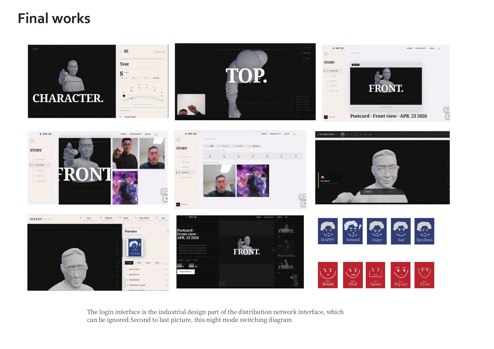
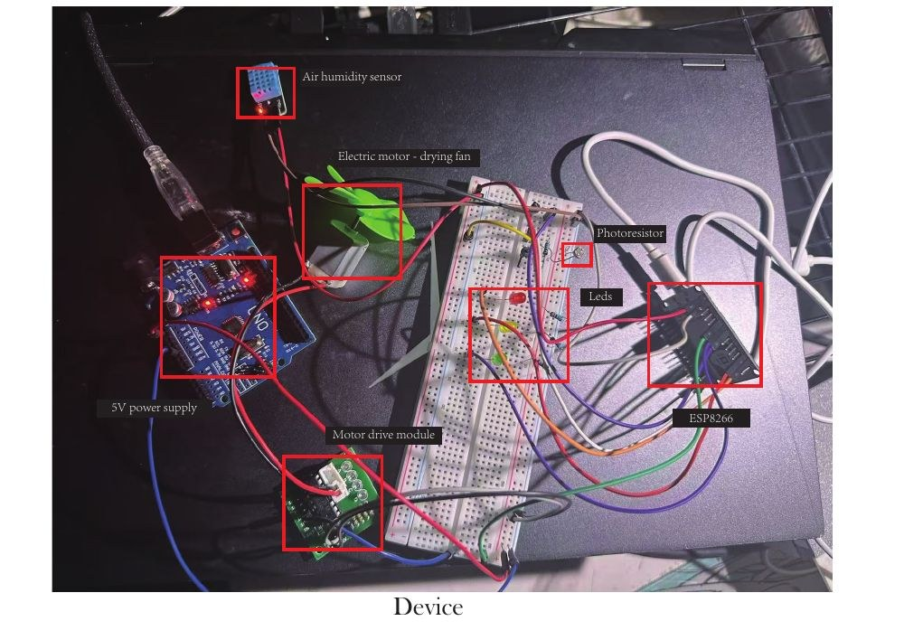
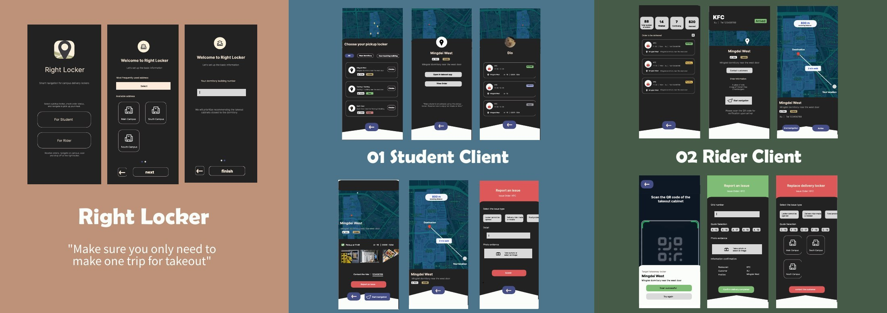
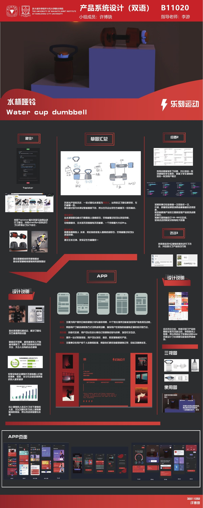
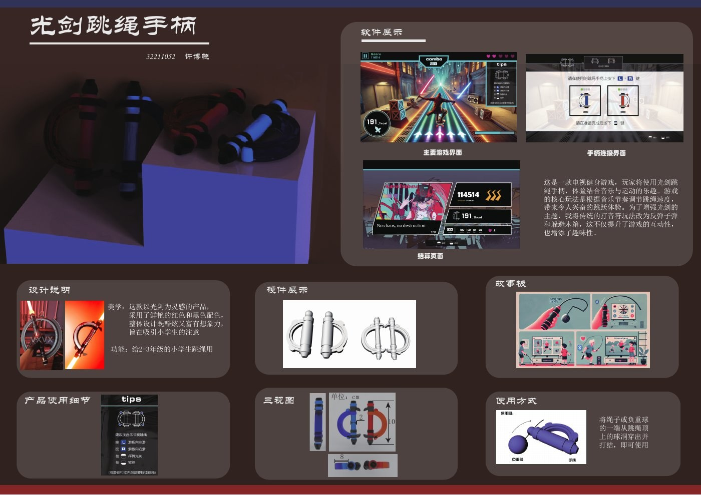
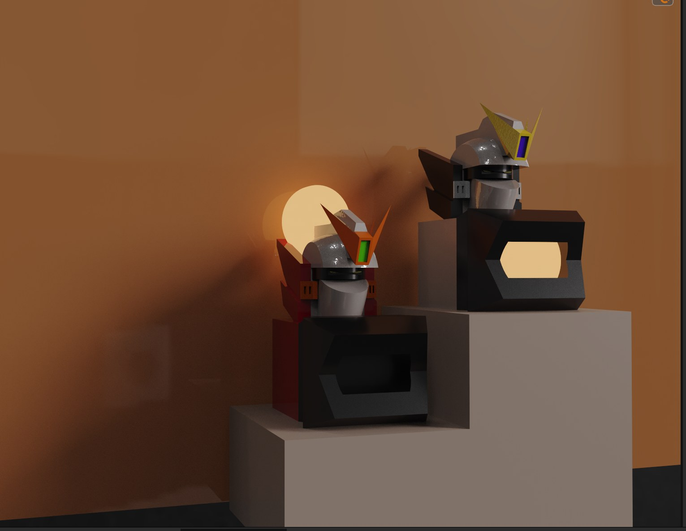
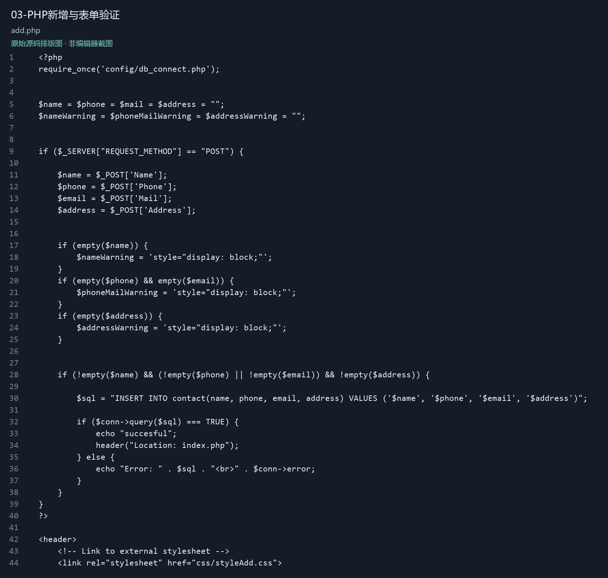

<strong>BOXIAO XU · 许博骁</strong>

# Engineering ideas into experiences.

Selected work across **AI, full-stack development, connected devices and design**.

我将产品设计、交互体验与软件和硬件实现结合，探索从概念到可用原型的完整过程。

Master of Information Technology student at **UNSW**, focusing on AI. Undergraduate dual-degree background: **Bachelor of Engineering + Bachelor of Design**, Zhejiang University City College × University of Waikato.

[GitHub profile](https://github.com/xuboxiao123) · [中文导览](README.zh-CN.md) · [Image sources and project scope](SOURCES.md)

## Featured work

### [AI + NFC Character Studio](project-ai-nfc-character.md)

A character-creation experience connecting generative AI, physical NFC cards, a web interface and 3D printing.

**AI / Full-stack / Physical interaction** · Vue · Spring Boot · MySQL · Three.js · ESP32 · RC522 · Image generation · Hunyuan3D

[Explore the project →](project-ai-nfc-character.md)

### [Event Management System](project-event-manager.md)

A React event-management interface with search, date sorting, forms and an Axios REST client.

**Web / Database** · JavaScript · React · Vite · Axios · REST API · Express / MySQL integration

[Explore the project →](project-event-manager.md)

## Project gallery

| Project | Focus | Explore |
|---|---|---|
| **AI + NFC Character Studio** AI 辅助的交互式三维人物编辑系统 | AI / Full-stack / Physical interaction | [Case study](project-ai-nfc-character.md) |
| **Event Management System** React 活动管理系统 | Web / Database | [Case study](project-event-manager.md) |
| **IoT Environment Monitor** ESP8266 环境监测与远程控制原型 | IoT / Embedded / Python | [Case study](project-iot-monitor.md) |
| **Right Locker** 校园配送柜双端服务设计 | UX / Service design | [Case study](project-right-locker.md) |
| **Smart Fitness** 智能健身产品与移动应用设计 | Product / UI / Visual identity | [Case study](project-smart-fitness.md) |
| **Lightsaber Jump Rope** 光剑跳绳：游戏化健身交互概念 | Interaction / Product design | [Case study](project-lightsaber-fitness.md) |
| **Modular Night Light** 模块化 3D 打印小夜灯 | Industrial design / Prototyping | [Case study](project-modular-lamp.md) |
| **PHP Contact Manager** PHP＋MySQL 联系人管理系统 | Web / SQL | [Case study](project-php-contacts.md) |

| [IoT Environment Monitor](project-iot-monitor.md) | [Right Locker](project-right-locker.md) |
|---|---|
|  |  |
| A sensor-to-controller loop using ESP8266, MQTT, Python, LEDs and a fan. | A two-sided delivery-locker experience for students and campus delivery riders. |

| [Smart Fitness](project-smart-fitness.md) | [Lightsaber Jump Rope](project-lightsaber-fitness.md) |
|---|---|
|  |  |
| A connected fitness concept spanning a physical product, a mobile application and visual identity. | A cordless jump-rope concept that maps exercise rhythms to game actions. |

| [Modular Night Light](project-modular-lamp.md) | [PHP Contact Manager](project-php-contacts.md) |
|---|---|
|  |  |
| A configurable night-light design built around interchangeable visual components. | A server-rendered contact-management application for practising forms and SQL CRUD. |

## What connects these projects

- **Software:** JavaScript, React, Vue, Java, PHP, Python and relational data.
- **Physical systems:** ESP8266/ESP32, Arduino, NFC and MQTT messaging.
- **Design:** user research, interaction flows, visual systems, 3D modelling and prototyping.

This is a curated showcase of undergraduate projects and prototypes. Individual case studies distinguish implemented code, design proposals, original renders and report boards. Images remain the original project work; publication does not imply that every historical service is currently running.

© Boxiao Xu. Project media is shared for portfolio review. Third-party brands, imagery and assets retain their original ownership.
