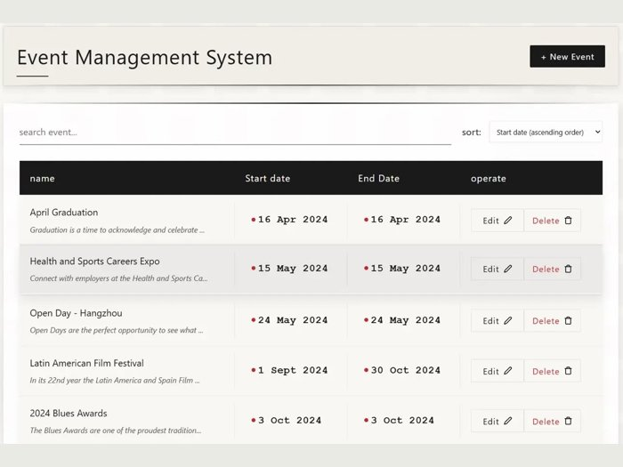
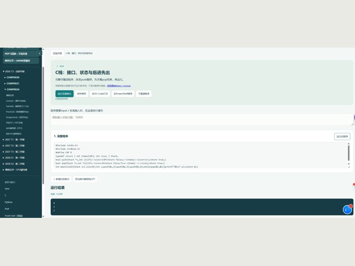
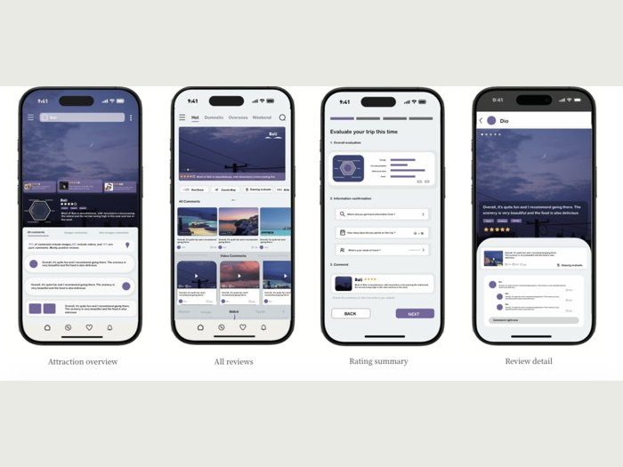
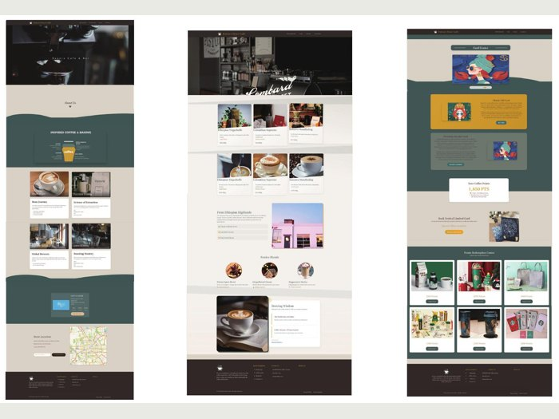
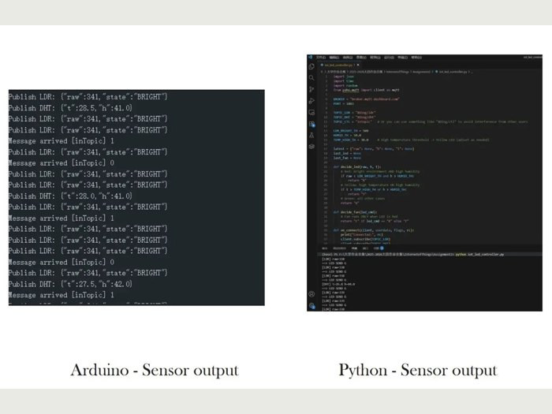
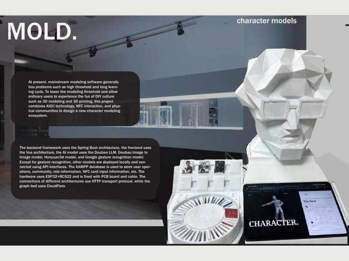
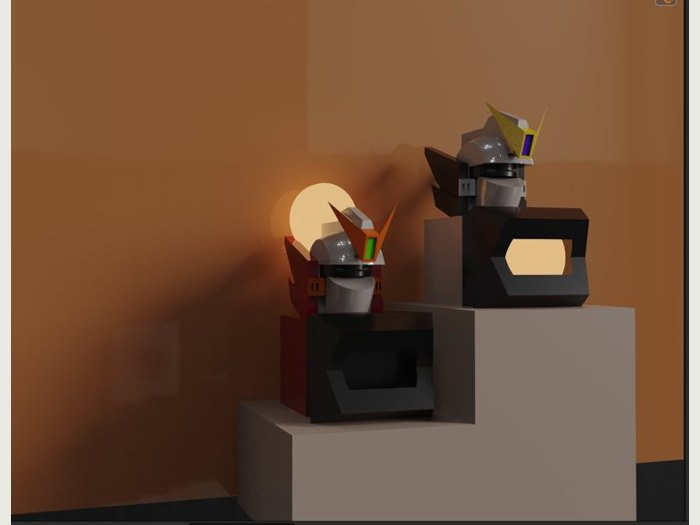
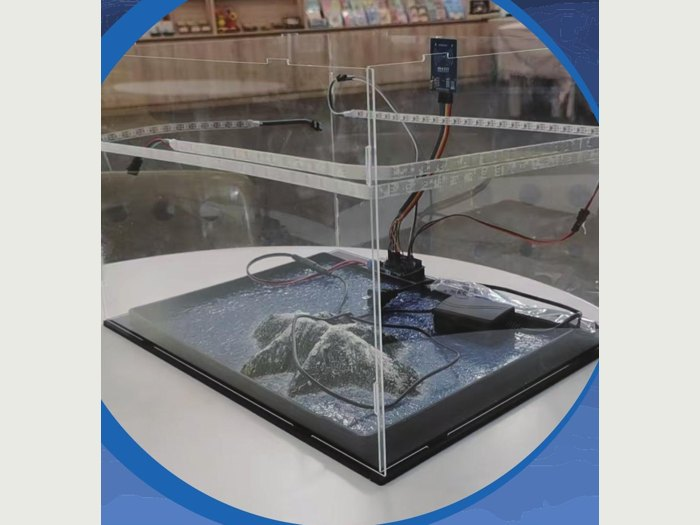
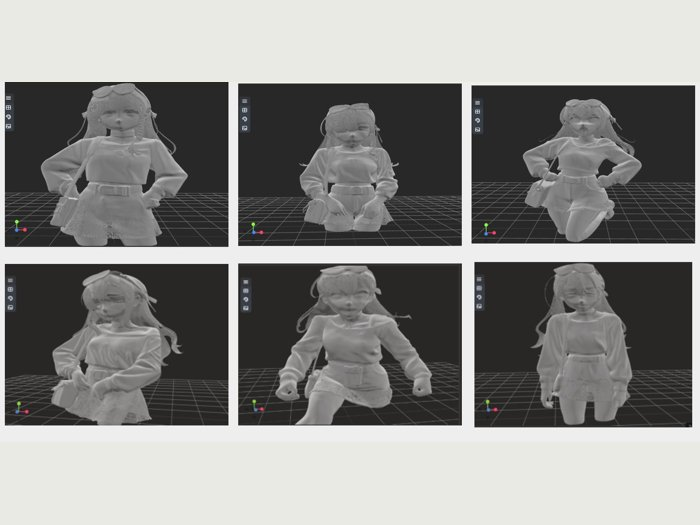

# Boxiao Xu · 许博骁

### AI · Full-stack development · Connected products

UNSW Master of Information Technology student (AI stream). **Bachelor of Engineering + Bachelor of Design**, Zhejiang University City College × University of Waikato.

I build across interfaces, backend services, AI workflows and physical prototypes. The screenshots and hardware photographs below are visible directly on GitHub.

[Project catalogue / 项目目录](docs/PROJECTS.md) · [Browse source / 源码](code) · [Public portfolio / 在线作品集](https://xuboxiao123.github.io/portfolio/) · [Five project films / 五段视频](https://xuboxiao123.github.io/portfolio/pages/films.html)

## Software engineering / 软件工程

| [MOLD. — AI + NFC Character Studio](docs/projects/project-ai-nfc-character.md) | [React Event Management System](docs/projects/project-event-manager.md) |
|:---:|:---:|
|  |  |
| **Vue · Spring Boot · MySQL · AI · ESP32/RC522** Character generation, 3D preview, editing, NFC presets and community workflows. 毕设：网页、后端、AI 与 NFC 实体交互。 | **React · Vite · Axios · REST API** Event listing, search, date sorting, create/edit forms and delete confirmation. React 活动管理与接口集成。 |
| [Project & pictures / 图文介绍](docs/projects/project-ai-nfc-character.md) · [Full source / 完整源码](https://github.com/xuboxiao123/NFC---3D-character-modeling) · [Video / 视频](https://xuboxiao123.github.io/portfolio/pages/films.html#capstone-interface) | [Project & screenshots / 图文介绍](docs/projects/project-event-manager.md) · [React source / 源码](code/react-events) · [API companion reference](code/event-api-reference) |

### Recent project — Personal Learning Workbench / 最近项目：个人学习平台

**JavaScript · Python · SQLite · JSON · local code execution.** Exam dates and revision scope, assignment deadlines with Sydney/Beijing time display, topic cards and mind maps, editable programming notebooks, and shortcuts to learning software. A standalone C example was run successfully for this capture.

[Project & screenshots / 图文介绍](docs/projects/project-learning-workbench.md) · [Source snapshot / 源码](code/learning-workbench) · [Download / 下载](downloads/learning-workbench-source.zip)

## Interface design / 界面设计

| [Smart Travel App / 旅行 App](docs/projects/project-smart-travel.md) | [Extract Hour Café / 咖啡网站](docs/projects/project-coffee-website.md) |
|:---:|:---:|
|  |  |
| Mobile review platform, smartwatch companion and dynamic itinerary concepts. 旅行评价 App、手表与动态行程卡概念。 | Website visual direction, page layouts and WordPress implementation. 咖啡网站视觉、页面设计与 WordPress 实现。 |
| [App screens & iteration / 界面与迭代](docs/projects/project-smart-travel.md) | [Website screens & film / 页面与演示](docs/projects/project-coffee-website.md) |

## Connected systems & automatic control / 物联网与自动控制

| [ESP8266 & MQTT Environment Monitoring](docs/projects/project-iot-monitor.md) | [Environmental Sensing & Automatic Actuation](docs/projects/project-environment-control.md) |
|:---:|:---:|
|  |  |
| **ESP8266 · MQTT/JSON · Python/Paho · DHT · LDR** Sensor publishing, control decisions and LED/fan feedback. 联网环境监测及智能控制。 | **Arduino · DHT · LDR · DC motor** Local sensor thresholds control motor actuation, with serial diagnostics. 环境感知与自动执行控制。 |
| [Hardware, wiring & test images / 接线与测试图](docs/projects/project-iot-monitor.md) · [Python controller / 源码](code/arduino-iot/iot_led_controller.py) | [Hardware, wiring & output / 接线与运行图](docs/projects/project-environment-control.md) · [Arduino sketch / 源码](code/arduino-iot/environment_motor.ino) |

### Backend & data evidence / 后端与数据流

| MQTT sensor publishing and Python control output | PHP/MySQL form handling and validation |
|:---:|:---:|
|  |  |
| Device telemetry and subscriber/control output from the original prototype. 设备发布与 Python 后端控制运行输出。 | Server-side request validation and contact insertion. PHP 服务端表单处理源码图。 |
| [MQTT project](docs/projects/project-iot-monitor.md) · [Source](code/arduino-iot/iot_led_controller.py) | [PHP project](docs/projects/project-php-contacts.md) · [Source & SQL](code/php-contacts) |

### More interface work / 更多界面项目

[Right Locker / 校园配送柜双端 UI/UX](docs/projects/project-right-locker.md) · [Travel website / 大二旅行网页](docs/projects/project-travel-website.md) · [HTML/CSS/JavaScript source](downloads/travel-website-source.zip) · [Web design notes / 网页设计图文目录](docs/projects/project-visual-design.md)

## Product design / 产品设计

| [MOLD. physical terminal / 毕设实体终端](docs/projects/project-ai-nfc-character.md) | [Smart Travel — Three Concepts / 旅行产品](docs/projects/project-smart-travel.md) | [Modular Night Light / 模块化小夜灯](docs/projects/project-modular-lamp.md) |
|:---:|:---:|:---:|
|  |  |  |
| AI, NFC controls and 3D printing. | Review app, smartwatch companion and dynamic itinerary card. | Rhino, KeyShot and modular physical prototyping. |

### [Blue Planet / 环保产品设计](docs/projects/project-blueplanet.md)

**Group coursework. My role: primary product concept and project implementation.** Team: Dio, Young, Alioth and Miuna. 小组作业；我的贡献：主要产品构想与项目实现。

More: [Super Fitness](docs/projects/project-smart-fitness.md) · [Lightsaber Jump Rope](docs/projects/project-lightsaber-fitness.md) · [One Arrow, Still Tide film](https://xuboxiao123.github.io/portfolio/pages/films.html#luban-lock).

## Published multimodal AI research / 已发表多模态 AI 研究

**Character Pose Generation and Editing Method Based on Large Model and Multimodal Prompt Words** — Boxiao Xu. Text, image and audio prompting with 2D pose editing, multi-view generation and 3D reconstruction.

Published **19 December 2025** in *Science and Technology of Engineering, Chemistry and Environmental Protection*, **3**(6), 13432.

[Project & figures / 图文介绍](docs/projects/project-multimodal-pose.md) · [Official article & full text / 正式论文](https://stecep.deanfrancis.press/article/view/482) · [DOI: 10.61173/8wq6d604](https://doi.org/10.61173/8wq6d604) · [Author manuscript](downloads/multimodal-character-pose-paper.docx)

## Code index / 源码索引

| Project | Implementation | Browse |
|---|---|---|
| AI + NFC capstone | Vue · Spring Boot · MySQL · ESP32 | [Code index](https://github.com/xuboxiao123/NFC---3D-character-modeling/blob/main/CODE_INDEX.md) |
| YOLOv5-guided object slicing | Python · OpenCV · target-region slicing | [Source](code/yolo-object-slicing) · [Individual contribution](docs/projects/project-yolo-slicing.md) |
| React Event Manager | React · Axios · REST client | [Source](code/react-events) |
| PHP Contact Manager | PHP · MySQL · server-side CRUD | [Source](code/php-contacts) |
| ESP8266 & MQTT | Python/Paho · JSON · device-control messages | [Source](code/arduino-iot/iot_led_controller.py) |
| Arduino automatic control | C/C++ · light/humidity sensing · motor control | [Source](code/arduino-iot/environment_motor.ino) |
| Java OOP & algorithms | Linked list · BST · hash table | [Source](code/java-algorithms) |
| Echo Study Helper | Personal Chrome-extension prototype | [Source](code/echo-study-helper) |
| Events API companion | Recovered Express/MySQL course reference | [Reference source](code/event-api-reference) |

[All project notes / 完整项目目录](docs/PROJECTS.md) · [Source audit / 源码核对](docs/SOURCE_AUDIT.md) · [Image sources / 图片来源](docs/SOURCES.md)

Original coursework and prototypes. Individual project notes identify implementation scope and contributions. Third-party images, brands and characters retain their original ownership.
