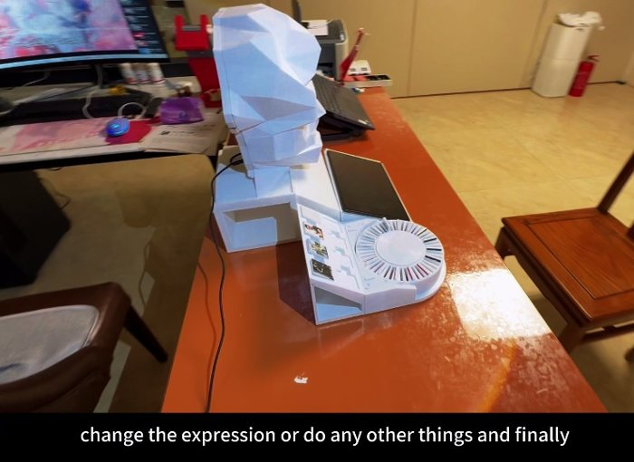
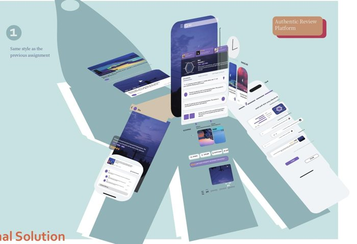
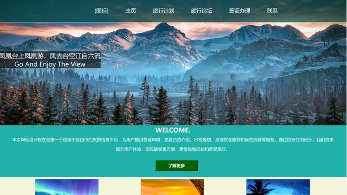
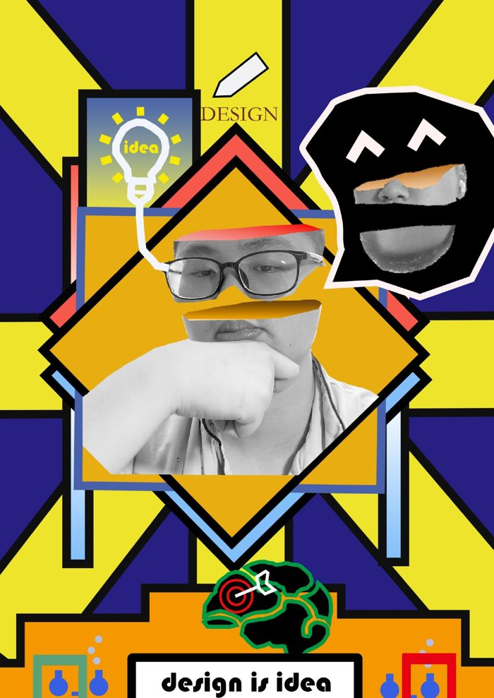

# Boxiao Xu · 许博骁

## Engineering ideas into experiences.

Selected work across **AI, full-stack development, connected devices and design**.

UNSW Master of Information Technology student (AI stream). Undergraduate background: **Bachelor of Engineering + Bachelor of Design**, Zhejiang University City College × University of Waikato.

从界面与软件，到实体产品与视觉设计，展示我从概念到原型的项目实践。

**[🌐 Public online portfolio / 公开在线作品集](https://xuboxiao123.github.io/portfolio/)** · **[▶ Five project films / 五段项目视频](https://xuboxiao123.github.io/portfolio/films.html)**

The online portfolio is publicly hosted on GitHub Pages. No local server or account is needed to view it.
网页公开托管在 GitHub Pages，别人可以直接打开，不需要运行本地服务或登录。

## Product design / 产品设计

### Selected renders & prototypes / 效果图与原型精选

| [AI + NFC Character Studio / AI 与 NFC 毕设](project-ai-nfc-character.md) | [Smart Travel / 旅行产品](project-smart-travel.md) | [Modular Night Light / 模块化小夜灯](project-modular-lamp.md) |
|:---:|:---:|:---:|
|  |  |  |
| Generative AI, NFC controls and 3D printing. 生成式 AI、NFC 实体控制与 3D 打印。 | Three concepts: review platform, smartwatch companion and dynamic itinerary card. 评价平台、旅行状态手表与动态行程卡。 | Rhino, KeyShot and a modular physical prototype. Rhino、KeyShot 与模块化实体原型。 |
| [Source code / 源码](https://github.com/xuboxiao123/NFC---3D-character-modeling) · [Video / 视频](https://xuboxiao123.github.io/portfolio/films.html#capstone-model) | [Three concepts / 三个方案](https://xuboxiao123.github.io/portfolio/travel-design.html) · [Iteration / 迭代过程](https://xuboxiao123.github.io/portfolio/travel-process.html) | [Project / 项目介绍](project-modular-lamp.md) |

More product work: [Super Fitness / 水杯哑铃](project-smart-fitness.md) · [Lightsaber Jump Rope / 光剑跳绳](project-lightsaber-fitness.md) · [One Arrow, Still Tide / 一箭定潮](https://xuboxiao123.github.io/portfolio/films.html#luban-lock).

**[Browse product renders / 查看产品效果图 →](https://xuboxiao123.github.io/portfolio/products.html)**

## Frontend & visual work / 前端与视觉作品

| [Travel Website / 大二旅行网站](project-travel-website.md) | [Posters & Visual Design / 海报与视觉设计](project-visual-design.md) |
|:---:|:---:|
|  |  |
| HTML/CSS/JavaScript: destinations, accommodation, reviews and itinerary pages. 目的地、住宿、评价与行程页面，已补原始前端源码。 | Year 2 onward: posters, typography, personal identity, pictograms and information design. 仅收录大二及之后的海报、字体、标志、图标和信息设计。 |
| [Preview / 预览](https://xuboxiao123.github.io/portfolio/travel-website.html) · [Source / 源码](travel-website-source.zip) | [Poster gallery / 海报分类](https://xuboxiao123.github.io/portfolio/visual-design.html) · [Logo / 个人标志](https://xuboxiao123.github.io/portfolio/visual-personal-identity.html) |

Other interface projects: [React Event Manager / React 活动管理](project-event-manager.md) · [Right Locker / 配送柜双端 UI/UX](project-right-locker.md) · [Coffee website film / 咖啡网站视频](https://xuboxiao123.github.io/portfolio/films.html#coffee-website).

## Backend, algorithms & source code / 后端、算法与源码

| Project / 项目 | Implementation / 实现 | Browse / 查看 |
|---|---|---|
| AI + NFC capstone / 毕设 | Java · Spring Boot · MySQL · Vue · ESP32 | [Code index / 源码索引](https://github.com/xuboxiao123/NFC---3D-character-modeling/blob/main/CODE_INDEX.md) |
| YOLOv5-guided object slicing / 实习切片算法 | Python · OpenCV · target-region slicing | [Source / 源码](code/yolo-object-slicing/) · [Contribution / 个人贡献](project-yolo-slicing.md) |
| React Event Manager / 活动管理 | React · Axios · REST client | [Frontend / 前端](code/react-events/) |
| PHP Contact Manager / 联系人管理 | PHP · MySQL · server-side CRUD | [Source / 源码](code/php-contacts/) |
| Arduino & MQTT / 物联网原型 | Arduino C/C++ · Python/Paho · MQTT | [Source / 源码](code/arduino-iot/) |
| Java OOP & algorithms / 面向对象与算法 | Linked list · BST · hash table | [Source / 源码](code/java-algorithms/) |
| Echo Study Helper / 学习插件 | Personal Chrome-extension prototype | [Source / 源码](code/echo-study-helper/) |
| Events API companion / 课程配套 API | Recovered Express/MySQL reference; independent backend authorship is not claimed. | [Reference / 参考源码](code/event-api-reference/) |

## Explore by category / 分类浏览

[Products / 产品](https://xuboxiao123.github.io/portfolio/products.html) · [Frontend / 前端](https://xuboxiao123.github.io/portfolio/frontend.html) · [Backend / 后端](https://xuboxiao123.github.io/portfolio/backend.html) · [Posters / 海报](https://xuboxiao123.github.io/portfolio/visual-design.html) · [Films / 视频](https://xuboxiao123.github.io/portfolio/films.html)

[Full project catalogue / 完整目录](PROJECTS.md) · [Source audit / 源码核对](SOURCE_AUDIT.md) · [Image sources / 图片来源](SOURCES.md)

Selected original coursework and prototypes. Third-party imagery, fonts, characters and brands retain their original ownership. Individual project notes distinguish implementations from design concepts.
