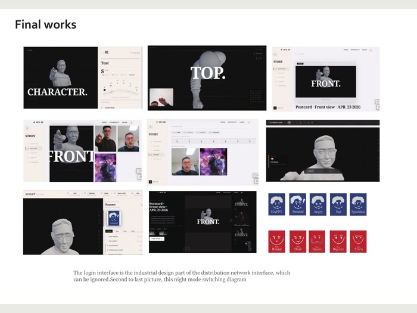
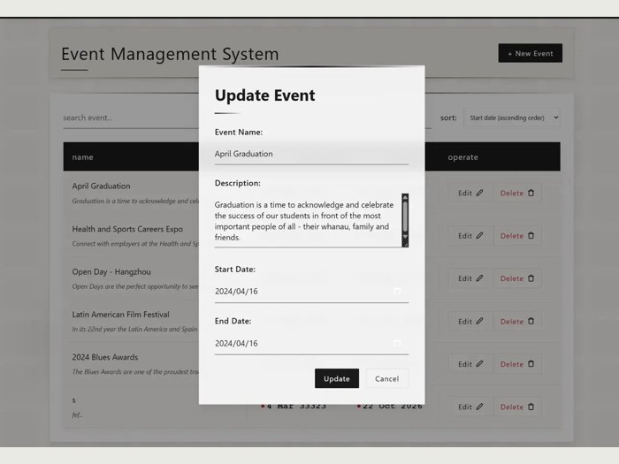
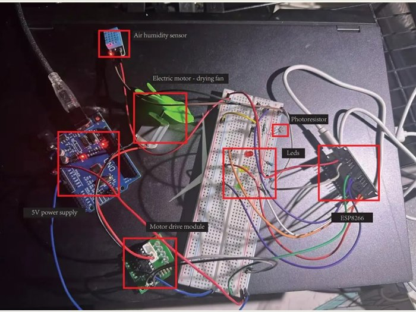
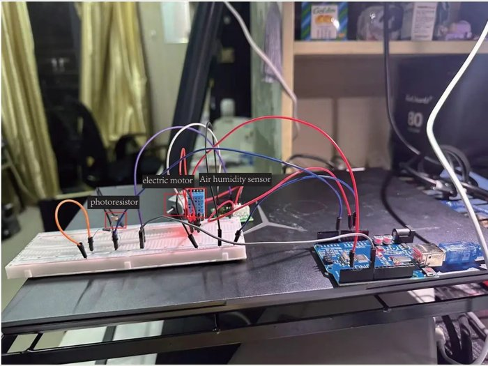
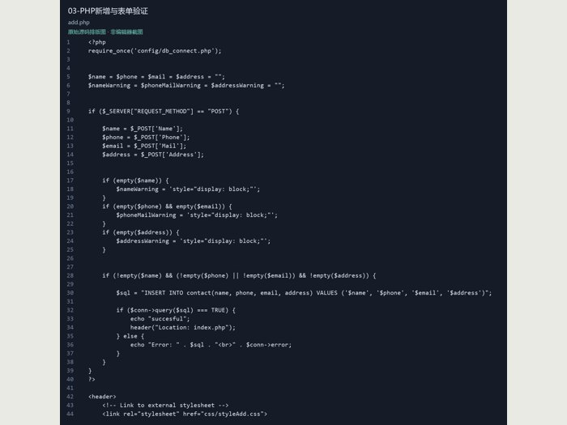
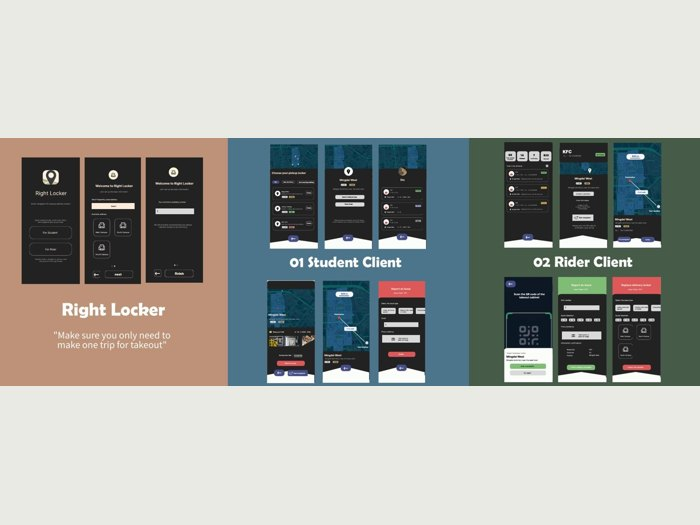

# Boxiao Xu · 许博骁

### AI · Full-stack development · Connected products

UNSW Master of Information Technology student (AI stream). **Bachelor of Engineering + Bachelor of Design**, Zhejiang University City College × University of Waikato.

I build across interfaces, backend services, AI workflows and physical prototypes. The screenshots and hardware photographs below are visible directly on GitHub.

[Project catalogue / 项目目录](PROJECTS.md) · [Browse source / 源码](code/) · [Public portfolio / 在线作品集](https://xuboxiao123.github.io/portfolio/) · [Five project films / 五段视频](https://xuboxiao123.github.io/portfolio/films.html)

## Featured engineering work / 软件与工程项目

| [MOLD. — AI + NFC Character Studio](project-ai-nfc-character.md) | [React Event Management System](project-event-manager.md) |
|:---:|:---:|
|  |  |
| **Vue · Spring Boot · MySQL · AI · ESP32/RC522** Character generation, 3D preview, editing, NFC presets and community workflows. 毕设：网页、后端、AI 与 NFC 实体交互。 | **React · Vite · Axios · REST API** Event listing, search, date sorting, create/edit forms and delete confirmation. React 活动管理与接口集成。 |
| [Project & pictures / 图文介绍](project-ai-nfc-character.md) · [Full source / 完整源码](https://github.com/xuboxiao123/NFC---3D-character-modeling) · [Video / 视频](https://xuboxiao123.github.io/portfolio/films.html#capstone-interface) | [Project & screenshots / 图文介绍](project-event-manager.md) · [React source / 源码](code/react-events/) · [API companion reference](code/event-api-reference/) |

### Interface details / 实际界面

| Character creation and community / 毕设界面 | React event editing / 活动编辑 |
|:---:|:---:|
|  |  |

## Connected systems & automatic control / 物联网与自动控制

| [ESP8266 & MQTT Environment Monitoring](project-iot-monitor.md) | [Environmental Sensing & Automatic Actuation](project-environment-control.md) |
|:---:|:---:|
|  |  |
| **ESP8266 · MQTT/JSON · Python/Paho · DHT · LDR** Sensor publishing, control decisions and LED/fan feedback. 联网环境监测及智能控制。 | **Arduino · DHT · LDR · DC motor** Local sensor thresholds control motor actuation, with serial diagnostics. 环境感知与自动执行控制。 |
| [Hardware, wiring & test images / 接线与测试图](project-iot-monitor.md) · [Python controller / 源码](code/arduino-iot/iot_led_controller.py) | [Hardware, wiring & output / 接线与运行图](project-environment-control.md) · [Arduino sketch / 源码](code/arduino-iot/environment_motor.ino) |

### Backend & data evidence / 后端与数据流

| MQTT sensor publishing and Python control output | PHP/MySQL form handling and validation |
|:---:|:---:|
|  |  |
| Device telemetry and subscriber/control output from the original prototype. 设备发布与 Python 后端控制运行输出。 | Server-side request validation and contact insertion. PHP 服务端表单处理源码图。 |
| [MQTT project](project-iot-monitor.md) · [Source](code/arduino-iot/iot_led_controller.py) | [PHP project](project-php-contacts.md) · [Source & SQL](code/php-contacts/) |

## Web & UI/UX design / 网页与界面设计

| [Extract Hour Café / 咖啡网站](project-coffee-website.md) | [Right Locker / 校园配送柜](project-right-locker.md) |
|:---:|:---:|
|  |  |
| WordPress website, visual direction, page composition and navigation. | Student/courier service flows, information architecture and UI/UX. |
| [Pictures & walkthrough / 图文与视频](project-coffee-website.md) | [Pictures & process / 图文与过程](project-right-locker.md) |

[Travel website / 大二旅行网页](project-travel-website.md) · [HTML/CSS/JavaScript source](travel-website-source.zip) · [Web design gallery / 网页设计图文目录](project-visual-design.md)

## Product design / 产品设计

| [MOLD. physical terminal / 毕设实体终端](project-ai-nfc-character.md) | [Smart Travel — Three Concepts / 旅行产品](project-smart-travel.md) | [Modular Night Light / 模块化小夜灯](project-modular-lamp.md) |
|:---:|:---:|:---:|
|  |  |  |
| AI, NFC controls and 3D printing. | Review app, smartwatch companion and dynamic itinerary card. | Rhino, KeyShot and modular physical prototyping. |

### [Blue Planet / 环保产品设计](project-blueplanet.md)

**Group coursework. My role: primary product concept and project implementation.** Team: Dio, Young, Alioth and Miuna. 小组作业；我的贡献：主要产品构想与项目实现。

More: [Super Fitness](project-smart-fitness.md) · [Lightsaber Jump Rope](project-lightsaber-fitness.md) · [One Arrow, Still Tide film](https://xuboxiao123.github.io/portfolio/films.html#luban-lock).

## Published multimodal AI research / 已发表多模态 AI 研究

**Character Pose Generation and Editing Method Based on Large Model and Multimodal Prompt Words** — Boxiao Xu. Text, image and audio prompting with 2D pose editing, multi-view generation and 3D reconstruction.

Published **19 December 2025** in *Science and Technology of Engineering, Chemistry and Environmental Protection*, **3**(6), 13432.

[Project & figures / 图文介绍](project-multimodal-pose.md) · [Official article & full text / 正式论文](https://stecep.deanfrancis.press/article/view/482) · [DOI: 10.61173/8wq6d604](https://doi.org/10.61173/8wq6d604) · [Author manuscript](multimodal-character-pose-paper.docx)

## Code index / 源码索引

| Project | Implementation | Browse |
|---|---|---|
| AI + NFC capstone | Vue · Spring Boot · MySQL · ESP32 | [Code index](https://github.com/xuboxiao123/NFC---3D-character-modeling/blob/main/CODE_INDEX.md) |
| YOLOv5-guided object slicing | Python · OpenCV · target-region slicing | [Source](code/yolo-object-slicing/) · [Individual contribution](project-yolo-slicing.md) |
| React Event Manager | React · Axios · REST client | [Source](code/react-events/) |
| PHP Contact Manager | PHP · MySQL · server-side CRUD | [Source](code/php-contacts/) |
| ESP8266 & MQTT | Python/Paho · JSON · device-control messages | [Source](code/arduino-iot/iot_led_controller.py) |
| Arduino automatic control | C/C++ · light/humidity sensing · motor control | [Source](code/arduino-iot/environment_motor.ino) |
| Java OOP & algorithms | Linked list · BST · hash table | [Source](code/java-algorithms/) |
| Echo Study Helper | Personal Chrome-extension prototype | [Source](code/echo-study-helper/) |
| Events API companion | Recovered Express/MySQL course reference | [Reference source](code/event-api-reference/) |

[All project notes / 完整项目目录](PROJECTS.md) · [Source audit / 源码核对](SOURCE_AUDIT.md) · [Image sources / 图片来源](SOURCES.md)

Original coursework and prototypes. Individual project notes identify implementation scope and contributions. Third-party images, brands and characters retain their original ownership.
