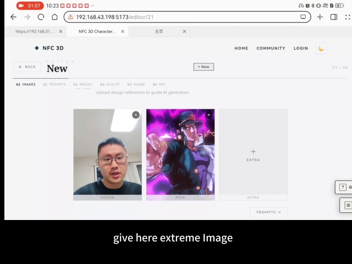
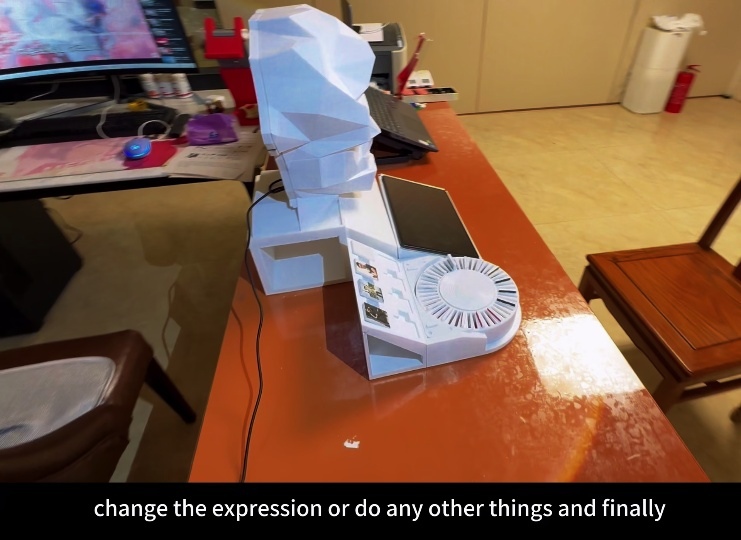
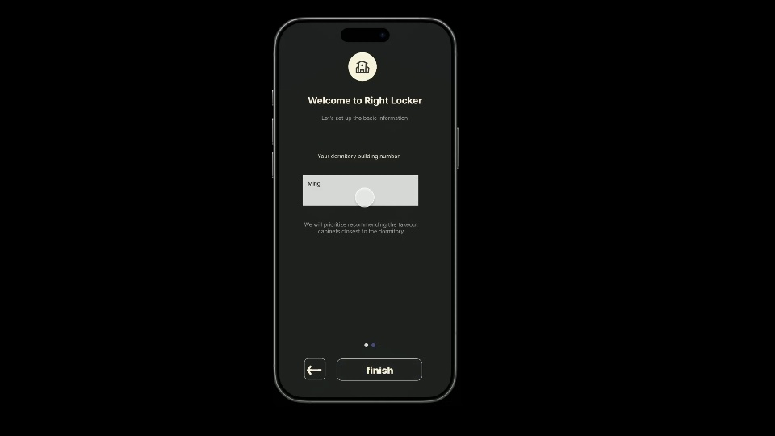
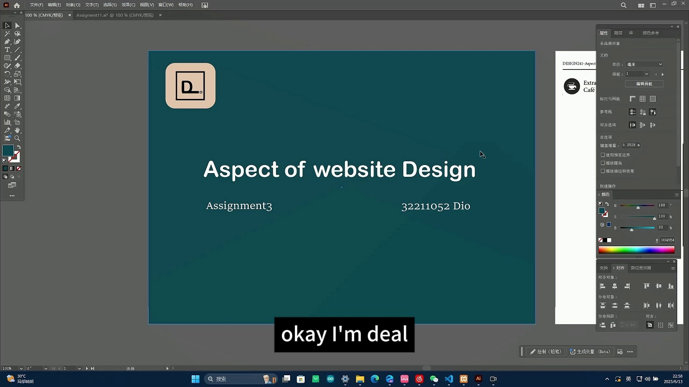
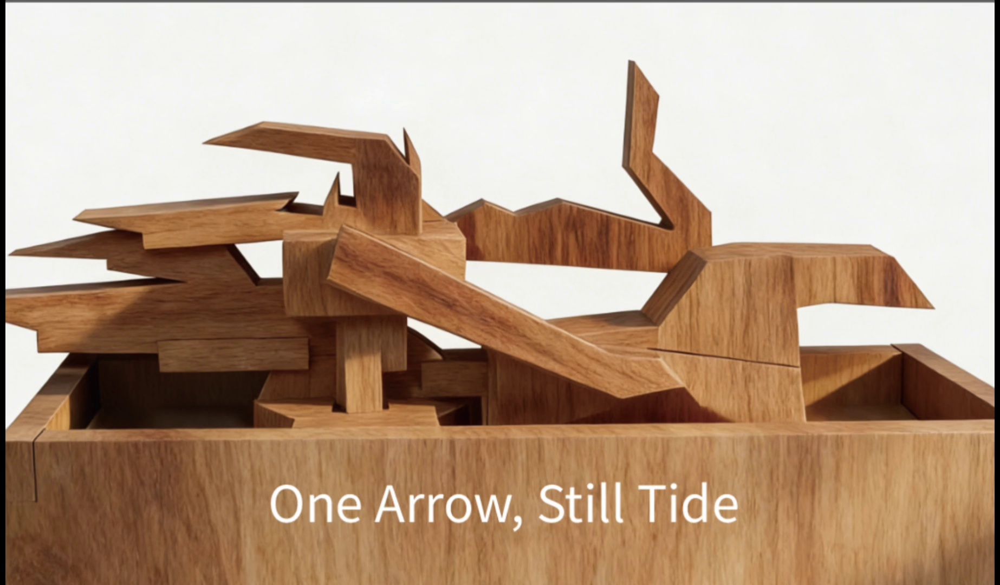

# 项目视频 / Project films

[← 返回作品集](README.md) · [中文导览](README.zh-CN.md)

5 段完整项目演示。点击封面或「播放视频」进入播放器；如预览未加载，可使用下载链接。

## 毕设 · 界面展示

**2:00** · 网页界面与交互流程演示。

[▶ 播放视频](videos/capstone-interface.mp4) · [下载 MP4](videos/capstone-interface.mp4?raw=true)

[项目介绍](project-ai-nfc-character.md) · [毕设源码导航](https://github.com/xuboxiao123/NFC---3D-character-modeling/blob/main/CODE_INDEX.md)

---

## 毕设 · 模型部分

**2:29** · 三维模型与实体交互演示。

[▶ 播放视频](videos/capstone-model.mp4) · [下载 MP4](videos/capstone-model.mp4?raw=true)

[项目介绍](project-ai-nfc-character.md) · [前端、后端与 ESP32 固件](https://github.com/xuboxiao123/NFC---3D-character-modeling/blob/main/CODE_INDEX.md)

---

## Right Locker · 外卖柜 App

**2:16** · 校园配送柜 App 的界面与服务流程展示。

[▶ 播放视频](videos/right-locker.mp4) · [下载 MP4](videos/right-locker.mp4?raw=true)

[项目介绍](project-right-locker.md)

---

## 咖啡网站 · 项目演示

**8:10** · 咖啡主题网站的完整项目演示。

[▶ 播放视频](videos/coffee-website.mp4) · [下载 MP4](videos/coffee-website.mp4?raw=true)

---

## 鲁班锁文玩 · One Arrow, Still Tide

**1:57** · 木质文玩与模型设计展示。

[▶ 播放视频](videos/luban-lock.mp4) · [下载 MP4](videos/luban-lock.mp4?raw=true)

---

视频由本人提供的项目原片转码，保留完整时长与原音轨；本页展示历史项目演示。
