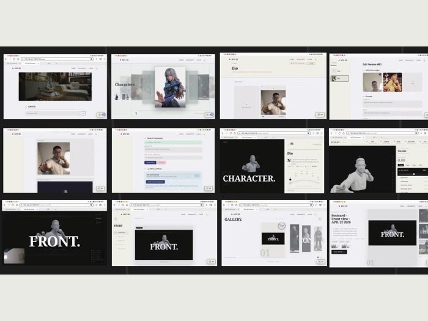

# Source Projects / 项目源码

Interfaces, backend/data workflows and connected-hardware prototypes. Each source folder has its own setup and scope notes.

## Frontend and full-stack interfaces

| [React Event Manager](react-events) | [AI + NFC Character Studio](https://github.com/xuboxiao123/NFC---3D-character-modeling) |
|:---:|:---:|
|  |  |
| React, Vite, Axios and REST-client integration. | Vue, Spring Boot, MySQL, AI services and ESP32/RC522. |
| [Project & screenshots](../docs/projects/project-event-manager.md) | [Project, interface and hardware](../docs/projects/project-ai-nfc-character.md) |

## Connected systems and automatic control

| [ESP8266 & MQTT Environment Monitoring](../docs/projects/project-iot-monitor.md) | [Arduino Automatic Control](../docs/projects/project-environment-control.md) |
|:---:|:---:|
|  |  |
| [Python MQTT controller](arduino-iot/iot_led_controller.py) | [Arduino sketch](arduino-iot/environment_motor.ino) |

## Backend, data and algorithms

| Project | Evidence and source |
|---|---|
| PHP/MySQL Contact Manager | [Source & SQL](php-contacts) · [Project notes](../docs/projects/project-php-contacts.md) |
| YOLOv5-guided object slicing | [Source](yolo-object-slicing) · [Individual internship contribution](../docs/projects/project-yolo-slicing.md) |
| Java OOP & algorithms | [Source](java-algorithms) |
| Echo Study Helper | [Extension source](echo-study-helper) |
| Events API companion | [Express/MySQL reference](event-api-reference); recovered course material, not claimed as independently authored backend work. |

[← Portfolio README](../README.md)
