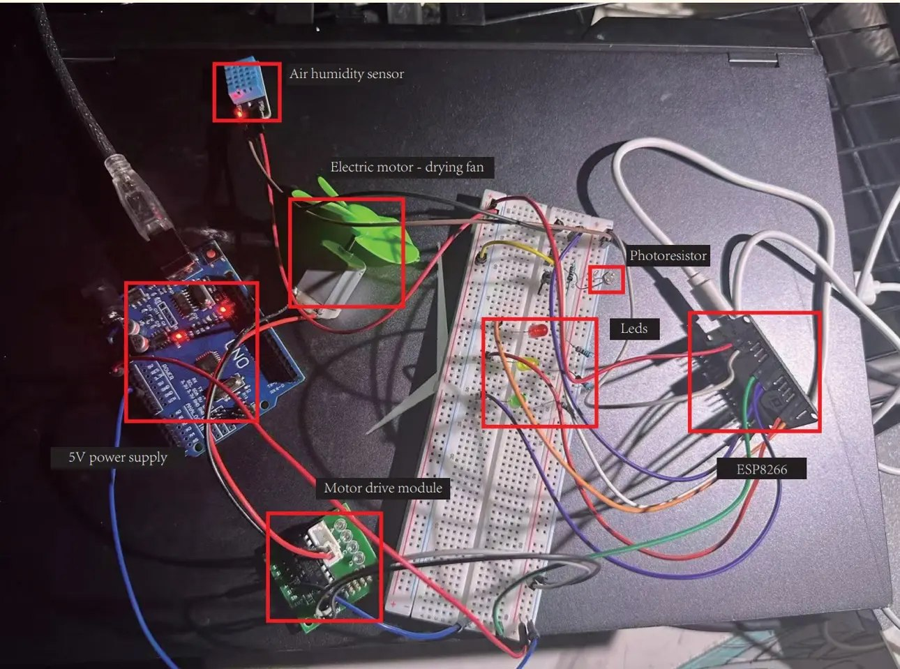
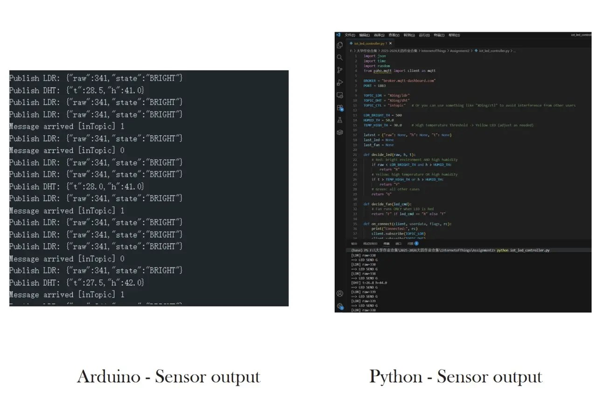

# Arduino & IoT Projects / 环境监测与自动控制

Two separate coursework prototypes: a networked ESP8266/MQTT system and a local Arduino sensing/actuation exercise.

## ESP8266 & MQTT Environment Monitoring

Temperature/humidity and light readings travel through MQTT as JSON. A Python/Paho subscriber combines the latest readings and sends LED/fan-control messages.

[Project, wiring and test pictures](../../project-iot-monitor.md) · [Python controller](iot_led_controller.py)

## Environmental Sensing & Automatic Actuation

The Arduino sketch uses light and humidity conditions to switch a DC motor and reports readings and state over serial.

[Project, wiring and implementation pictures](../../project-environment-control.md) · [Arduino sketch](environment_motor.ino)

## Source revisions

The Arduino sketch and MQTT Python controller belong to distinct exercises. They are not interchangeable firmware/controller halves. The archived sketch retains its original pins and humidity threshold of 100; the owner-supplied implementation screenshot shows another revision. The concept diagrams label DHT22, while implementation evidence uses DHT11.

The archive file named `mqtt_esp8266.ino` contained NFC-reader code and was excluded from this MQTT source folder. Matching ESP8266 MQTT firmware has not been established from that archive.

[← Source index](../README.md) · [Portfolio README](../../README.md)
