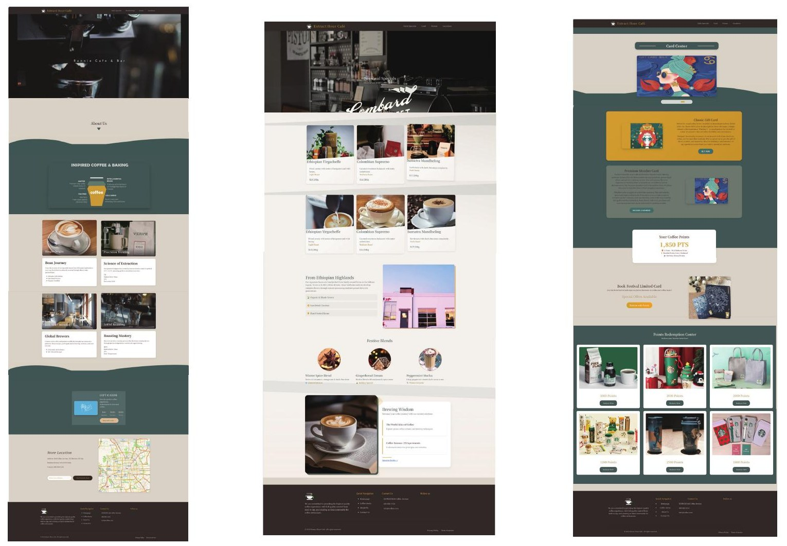
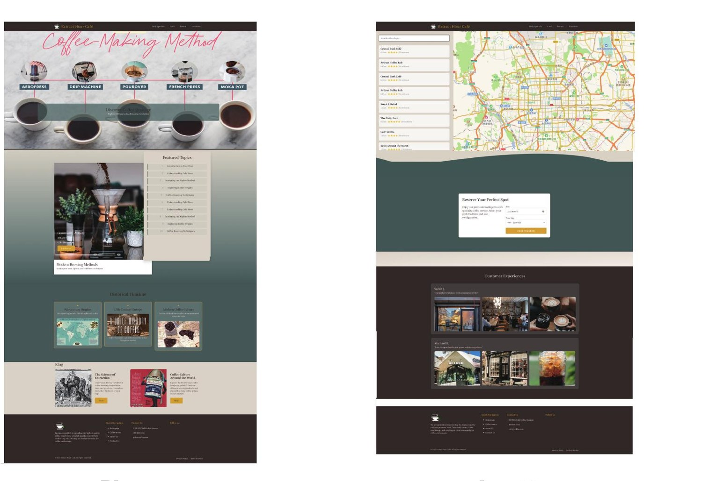

[← Portfolio](../../README.md)

# Extract Hour Café / 咖啡网站设计

A café website coursework project combining visual direction, page layout, navigation and a WordPress implementation. The interface studies cover homepage content, menus, cards, blog and store-location pages.

**Work shown:** original page-design studies and the owner-supplied WordPress walkthrough. Third-party photographs and brand imagery retain their original ownership.

[Watch the full walkthrough](https://xuboxiao123.github.io/portfolio/pages/films.html#coffee-website) · [Online project page](https://xuboxiao123.github.io/portfolio/pages/coffee-website.html)

## Blog and location / 博客与门店位置

