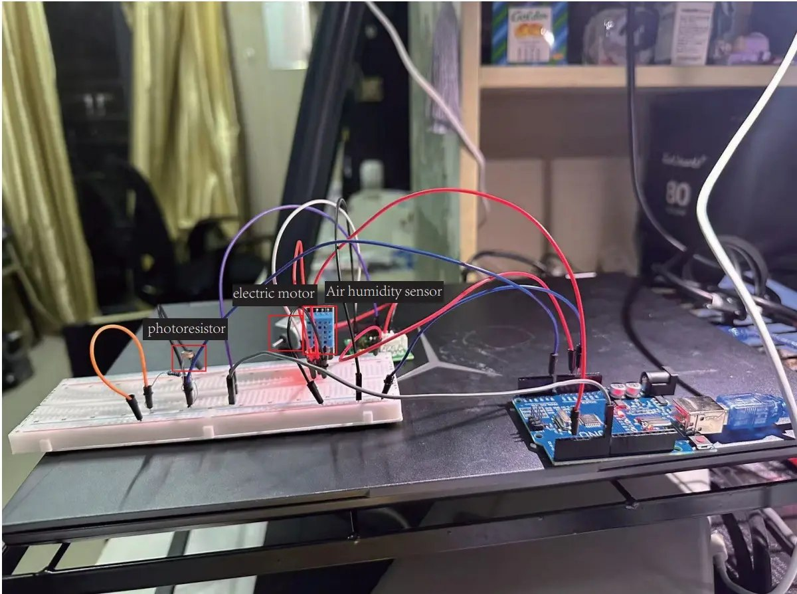
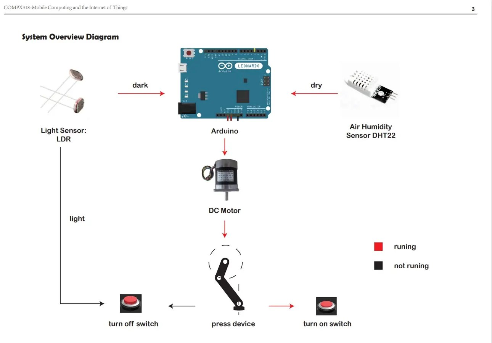
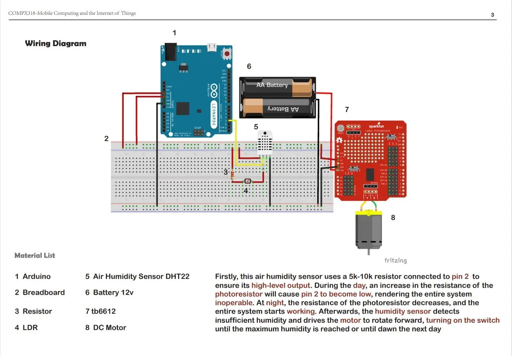
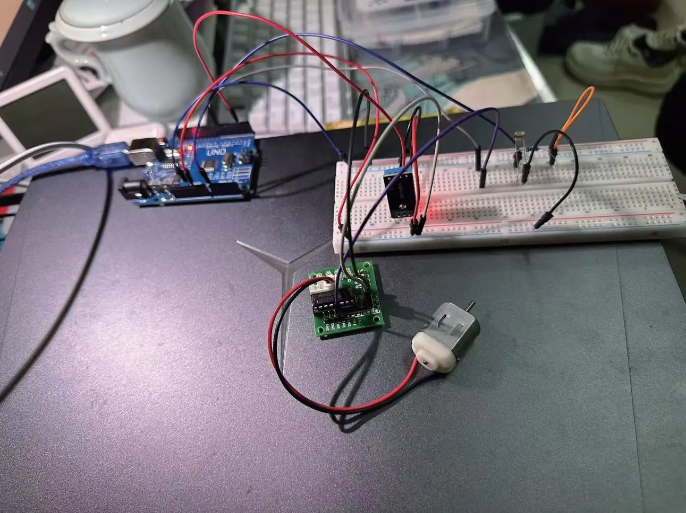
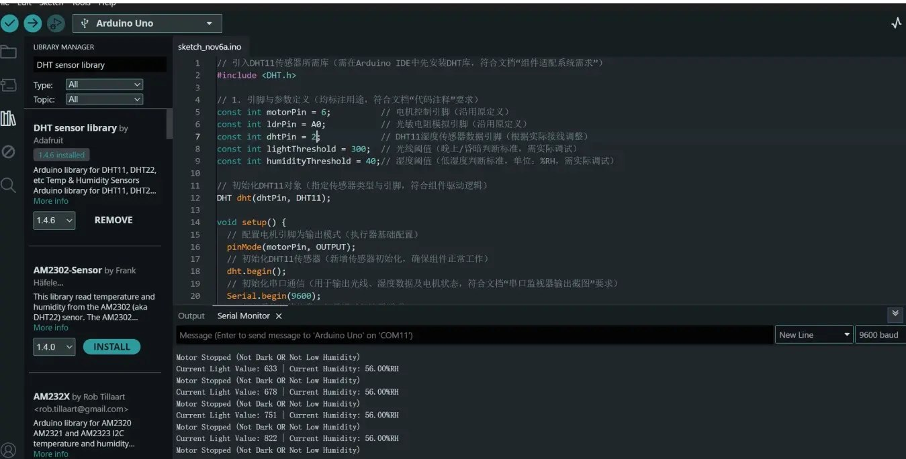

[← Portfolio](../../README.md)

# Environmental Sensing & Automatic Actuation / 环境感知与自动执行控制系统

**Arduino · LDR · DHT11 · DC motor · Serial diagnostics**

[Project gallery](https://xuboxiao123.github.io/portfolio/pages/environment-control.html) · [Arduino source](../../code/arduino-iot/environment_motor.ino)

This local Arduino exercise combines light and humidity readings to start a DC motor when both conditions are met: a dark environment and humidity below a threshold. Otherwise the motor is stopped. Serial output reports readings and actuator state.

## Wiring and system concept

## Implementation evidence

The owner-supplied design diagrams label Leonardo/DHT22; the implementation screenshot shows Uno/DHT11 with its own pin assignments and thresholds. The archived source is a separate historical revision, with motor pin 8 and original threshold values retained. No new hardware test is claimed. This is distinct from the ESP8266/MQTT networked monitoring project.
