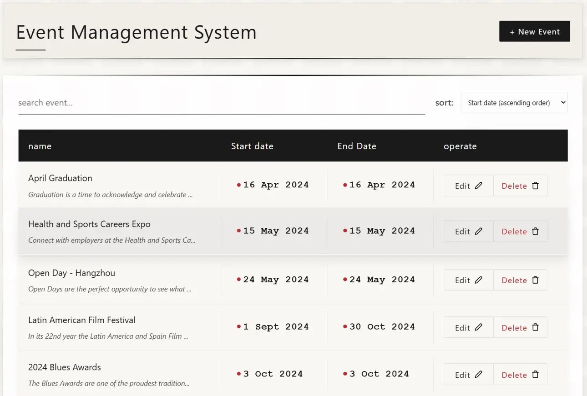
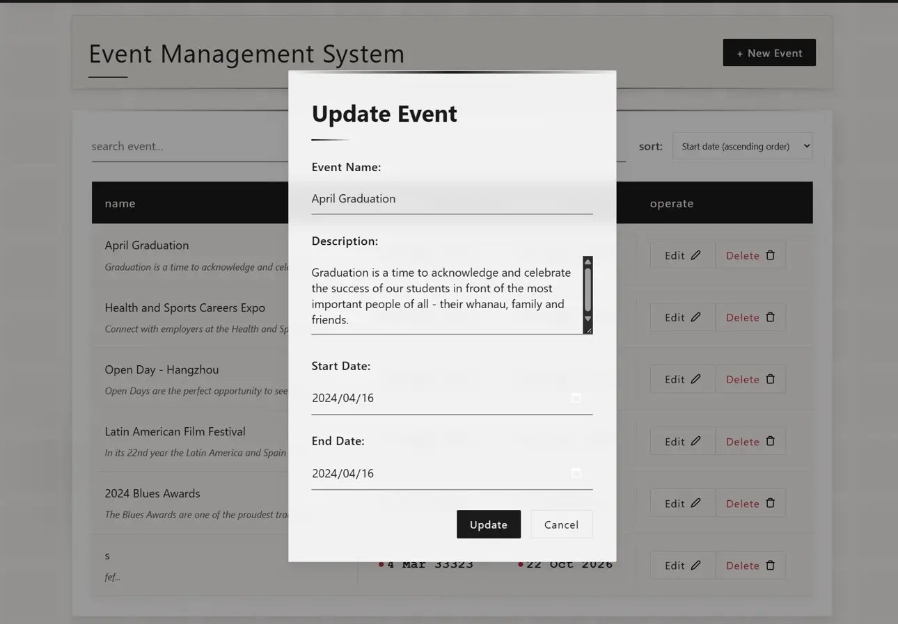
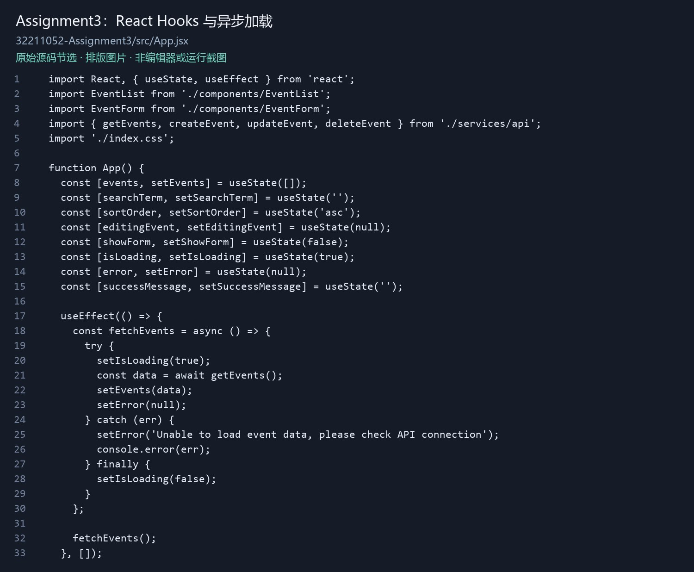
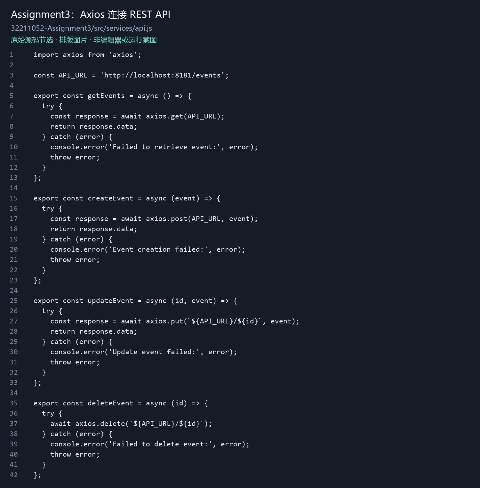

[← Portfolio](../../README.md)

# Event Management System




**React 活动管理系统**

A React event-management interface with search, date sorting, forms and an Axios REST client.

使用 React 组件与 Hooks 管理活动列表、搜索、日期排序和新增／编辑表单，通过 Axios 对接 REST API。

**Tools & technologies:** JavaScript · React · Vite · Axios · REST API · Express / MySQL integration

## Features verified in the original frontend
- Load event records and show loading or request-error feedback.
- Search by name and sort by date.
- Create and edit events through a reusable form.
- Delete records after user confirmation and show success feedback.
- Separate API requests from UI components.

## Source
[Browse the original frontend](../../code/react-events) · [App component](../../code/react-events/src/App.jsx) · [API client](../../code/react-events/src/services/api.js)

```text
React components → Axios → Express REST API → MySQL
```

The repository includes the frontend from the student submission directory. The REST backend is an integration dependency and is not included here. An alternate complete backend found under a different student's submission identifier has deliberately not been presented as personal authorship.

## Application screenshots

[Open project gallery](https://xuboxiao123.github.io/portfolio/pages/react-events.html)




Screenshots supplied by the owner show the interface and edit dialog; they do not establish a fresh database-backed test of this archive.

## Code visuals


*These are formatted images of original source code, not application screenshots or current end-to-end test results.*

## Running the frontend
```sh
cd code/react-events
npm ci
npm run dev
```
Requires Node.js and a compatible events API. The original API client targets `http://localhost:8181/events`; update it for your environment. The UI expects event records with id, name, description, startdate and enddate.

## Status
Original source reviewed for this portfolio. No current database-backed CRUD verification is claimed.


## Companion backend recovered / 已补充配套后端

[Express / MySQL API source](../../code/event-api-reference) · [Download API source](../../downloads/event-api-reference-source.zip)

The frontend's localhost:8181/events endpoint matches the recovered API. The API is archived as course-companion reference material; authorship could not be established from the download, so it is not claimed as independently authored work. The publication copy uses environment variables for database settings. / 配套 API 的端口与当前前端一致；按课程参考材料标注，数据库配置改为环境变量。未声称此次已完成真实数据库联调。

