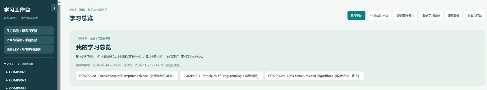
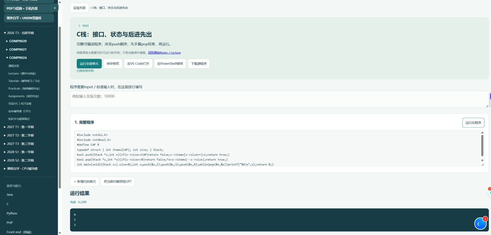

[← Portfolio](../../README.md)

# Personal Learning Workbench / 个人学习平台

A personal learning platform that connects course organisation, programming practice and local learning tools. Built iteratively with AI coding assistance, with product choices driven by day-to-day study and repeated refinement.

**Stack:** JavaScript · HTML/CSS · Python HTTP server · SQLite · JSON · local language toolchains.

## Editable code and real execution / 代码编辑与实际运行

The screenshot records a successful local run of the standalone stack demonstration: output **8, 5, 2**, exit code **0**. The workbench provides code cells, standard input, execution controls and result panels. This check verifies that example, not every runtime or feature.

## Implementation and scope

- Course and subject navigation, learning cards and reusable views.
- Editable notebooks with local Python, Java, C/C++ and PHP integrations, subject to installed toolchains.
- Python JSON endpoints, queued execution jobs, time/output limits and error reporting.
- SQLite notes and prototype records, JSON learning state and backup/restore tools.
- Document/mistake tools, mobile companion and floating notes are included as supporting modules; a full regression test of these modules is not claimed.

[Browse the public source snapshot](../../code/learning-workbench) · [Download source](../../downloads/learning-workbench-source.zip)

The application runs locally. This public project presentation and screenshots can be viewed without starting it. The exported source uses demonstration data and excludes personal records, course PDFs, transcripts, databases and local machine configuration.
