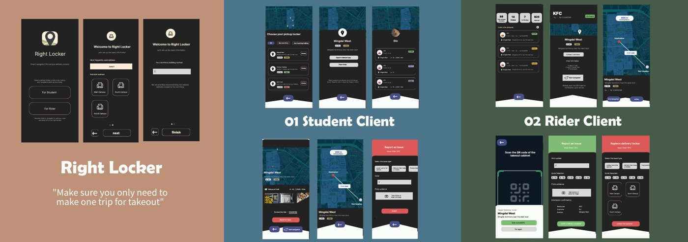
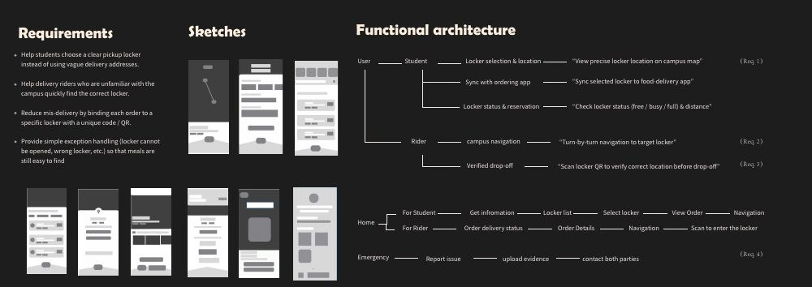

[← Portfolio](../../README.md)

# Right Locker

[▶ 在线播放全部 5 段视频](https://xuboxiao123.github.io/portfolio/)

**校园配送柜双端服务设计**

A two-sided delivery-locker experience for students and campus delivery riders.

从学生和配送员两端优化校园外卖取餐流程，通过柜体定位与编码验证减少找错柜、投错柜的问题。

**Tools & technologies:** Figma · User research · Storyboards · Information architecture · Mobile UI

## Problem
Students can struggle to identify their pickup locker, while riders unfamiliar with campus can deliver to the wrong location.

## Design process
Problem framing, questionnaires and interviews, requirements, storyboards, low-fidelity wireframes, functional architecture and high-fidelity screens.

## Student experience
Explore campus locker locations, choose a locker, check status/distance and follow order or navigation information.

## Rider experience
Review delivery details, navigate to a campus locker and verify its unique code/QR before drop-off. Exception flows include reporting a problem and attaching evidence.

*Original project presentation, page 5.*

*Original project presentation, page 4.*

## Scope
UI/UX and service-design proposal. Screens document the proposed experience; a deployed locker network is not claimed.

## 视频演示

- [▶ Right Locker · 外卖柜 App（2:16）](https://xuboxiao123.github.io/portfolio/#right-locker)

[查看全部项目视频 →](../VIDEOS.md)

