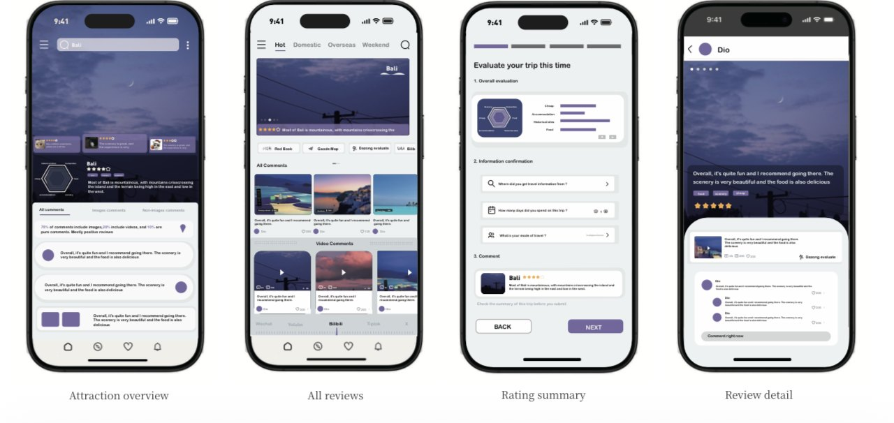
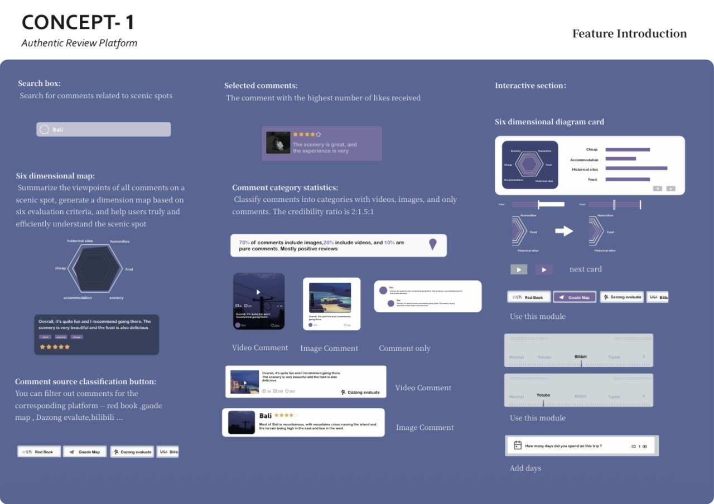
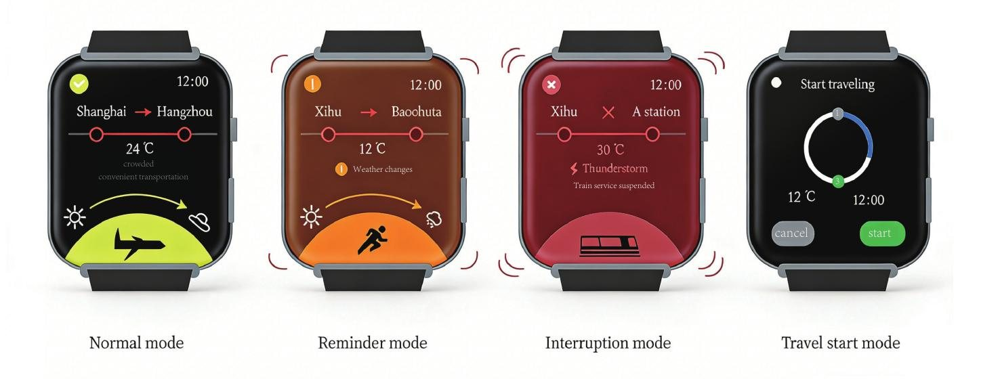
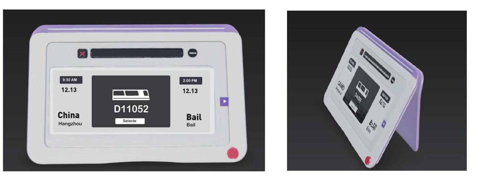
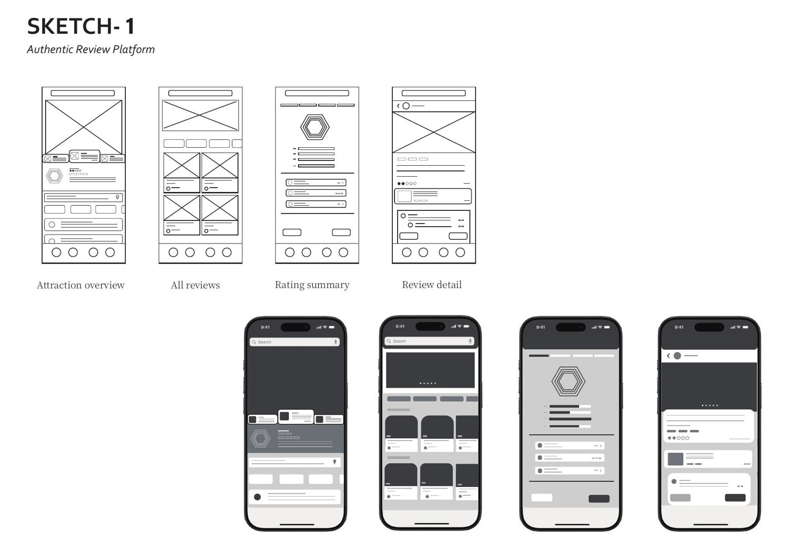
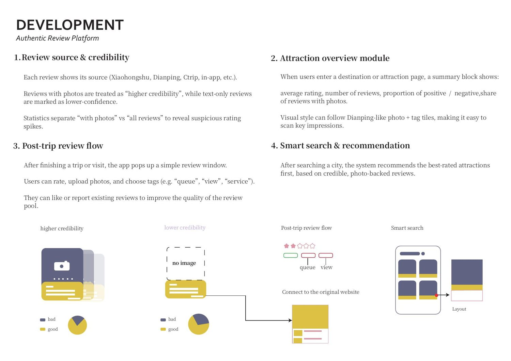

# Smart Travel — Three Concepts / 旅行产品设计

[View final visuals](https://xuboxiao123.github.io/portfolio/pages/travel-design.html) · [Sketches & iteration](https://xuboxiao123.github.io/portfolio/pages/travel-process.html)

User-centred design coursework exploring an Authentic Review Platform, a Real-time Status Travel Tag (smartwatch companion), and an Auto-adjust Plan with Dynamic Itinerary Card. The final solution refines the review platform after research and feedback. These are interface/physical product concepts, not a deployed service.

## Review-platform interface / 旅行评价界面

## Other product concepts / 另外两个产品方案

## Sketches and iteration / 草图与迭代

