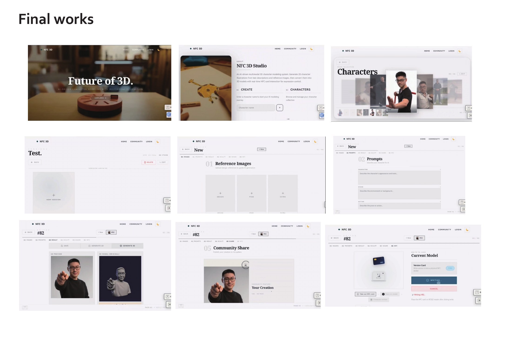
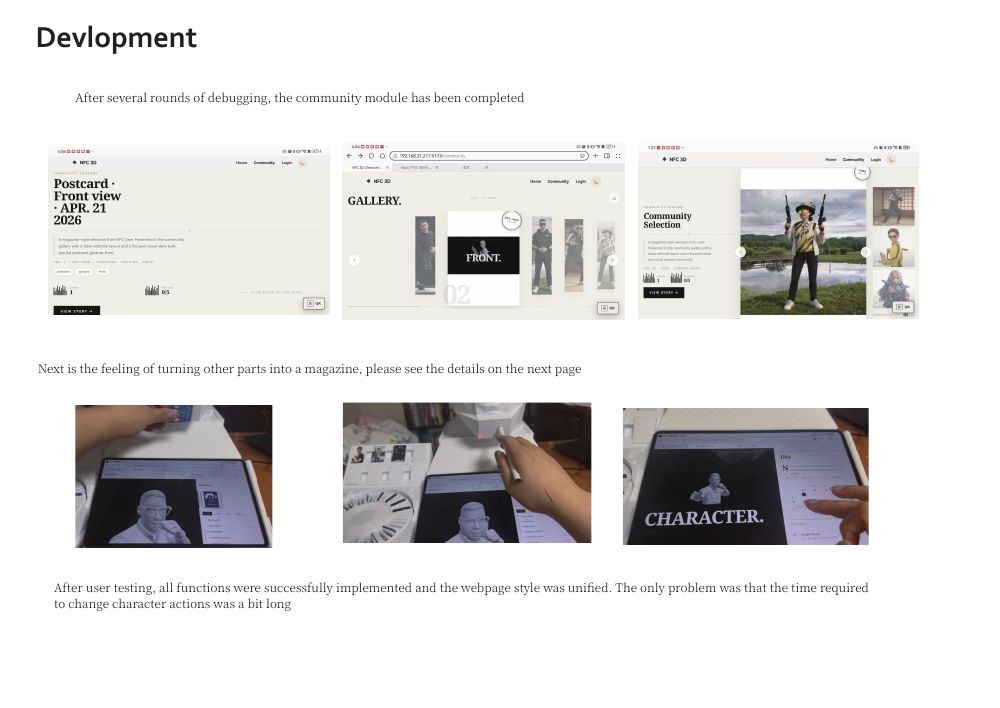
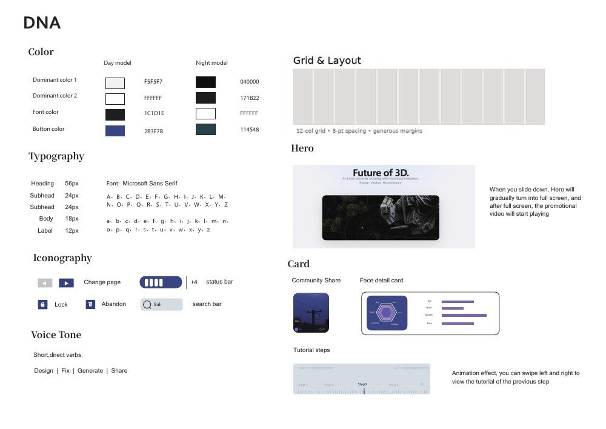

[← Portfolio](README.md)

# AI + NFC Character Studio

[Browse the capstone implementation](https://github.com/xuboxiao123/NFC---3D-character-modeling)

**AI 辅助的交互式三维人物编辑系统**

A character-creation experience connecting generative AI, physical NFC cards, a web interface and 3D printing.

结合生成式 AI、NFC 实体卡片与交互装置，降低普通用户创作三维角色的门槛，并串联模型预览、编辑与打印。

**Tools & technologies:** Vue · Spring Boot · MySQL · Three.js · ESP32 · RC522 · Image generation · Hunyuan3D

## Problem and approach
Traditional 3D tools can be difficult for first-time users. The project explores a guided create-edit-print workflow with physical interaction and visible on-screen feedback.

## Project work
- Research and interface planning: market comparisons, personas, interviews, sketches and user feedback.
- Vue interface backed by Spring Boot and MySQL; model browsing and preview with Three.js.
- ESP32 and RC522 NFC readers connect physical selections to character features.
- Image-generation and Hunyuan3D workflows support character creation; physical editing and 3D printing connect digital output to a tangible prototype.
- A shared visual system brings together model creation, editing, community browsing and postcard-style presentation.

## Visual evidence

*Final interface boards from the original 2026 capstone process book, page 35.*

*Original interface overview, page 34.*

*Development record and physical interaction images, page 33.*

*Typography, colours, interface components and layout exploration, page 26.*

## Scope
Undergraduate capstone prototype and design case study. The boards document the original project; they are not a claim that the AI services or hardware are currently deployed.

[Related implementation repository](https://github.com/xuboxiao123/NFC---3D-character-modeling)
