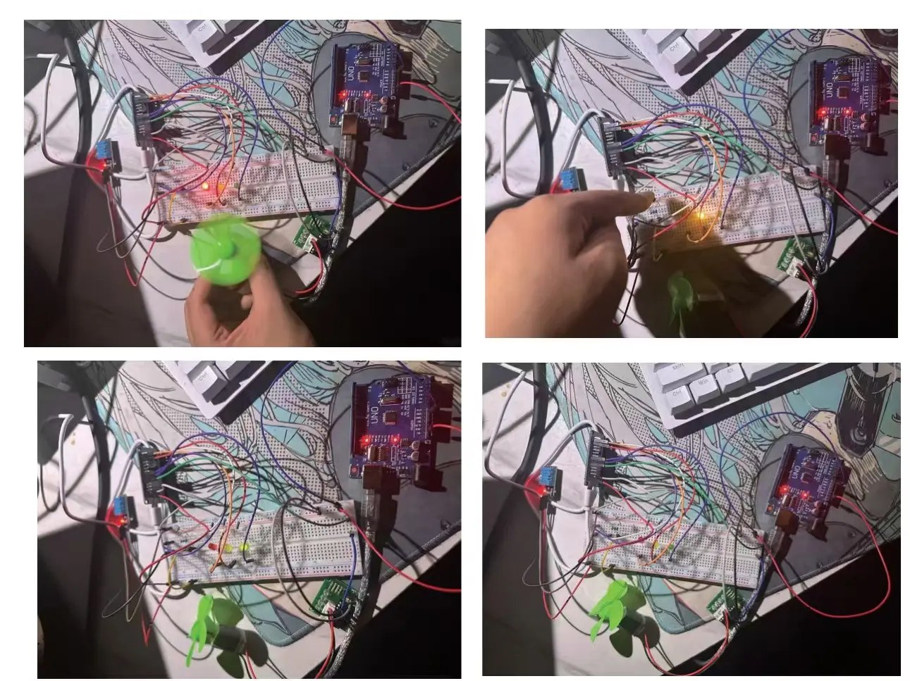
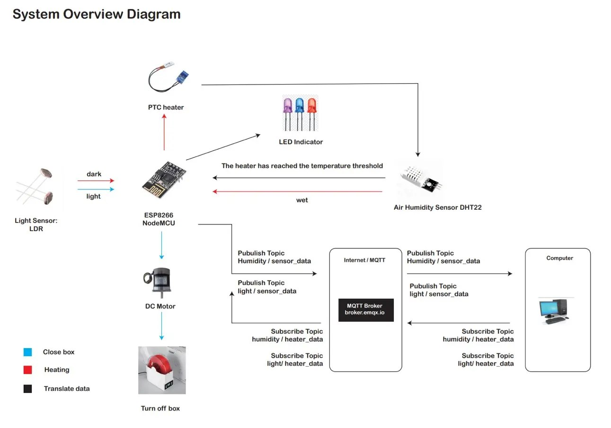
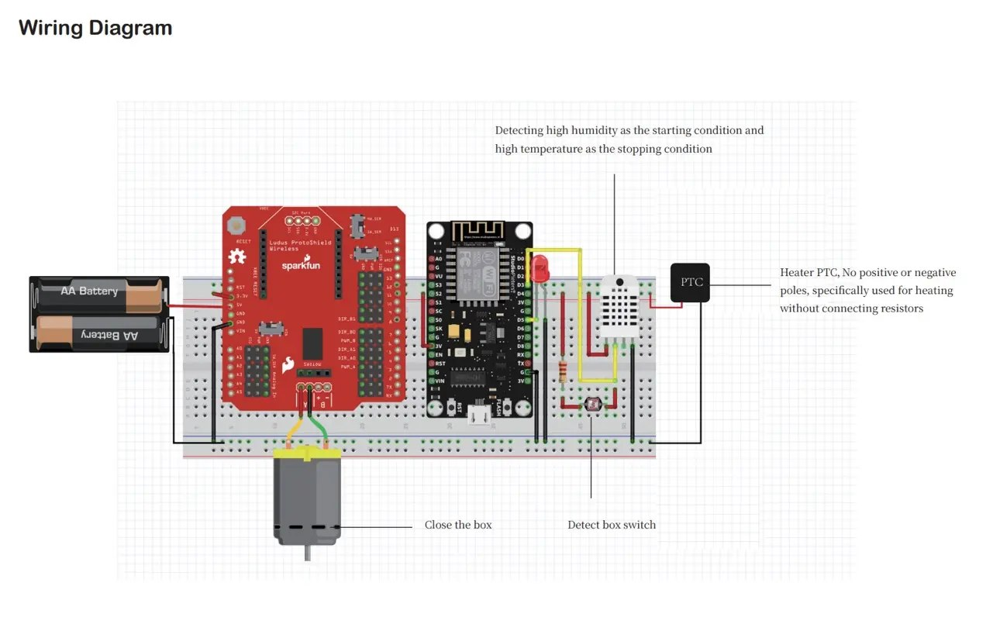

[← Portfolio](README.md)

# IoT Environment Monitor

[Project gallery](https://xuboxiao123.github.io/portfolio/iot-environment.html) · [Python MQTT controller](code/arduino-iot/iot_led_controller.py) · [Separate Arduino project](project-environment-control.md)

**ESP8266 环境监测与远程控制原型**

A sensor-to-controller loop using ESP8266, MQTT, Python, LEDs and a fan.

围绕 3D 打印耗材干燥场景，完成温湿度和光照采集、MQTT 消息传输及 LED／风扇控制的概念验证。

**Tools & technologies:** ESP8266 · Arduino C/C++ · DHT11 · LDR · MQTT · JSON · Python · Paho-MQTT

## From scenario to prototype
The original proposal explores keeping 3D-printing filament dry. The proof of concept demonstrates environmental sensing and LED/fan actuation rather than a finished temperature-controlled drying appliance.

## Implemented loop
1. ESP8266 reads a DHT11 sensor and an LDR.
2. Sensor readings are sent as JSON over separate MQTT topics.
3. A Python subscriber combines the latest readings and selects a status colour.
4. Control messages return through MQTT to drive LEDs and the fan.

The source controller distinguishes red, yellow and green states using light, humidity and temperature thresholds. The fan is enabled in the red state, with shutdown messages on disconnect/exit.

*Original Assignment 2B report, pages 2 and 6.*

[Read the original Python controller](iot_led_controller.py)

## Scope
Bench proof of concept with a motor/fan. The initial proposal mentions DHT22; the implementation report and code document DHT11. Firmware with Wi-Fi configuration is not distributed in this showcase.

## System, wiring and messaging evidence

Additional images supplied by the owner. The system diagram is a concept reference; the bench tests demonstrate the sensor, LED and motor/fan control loop.
