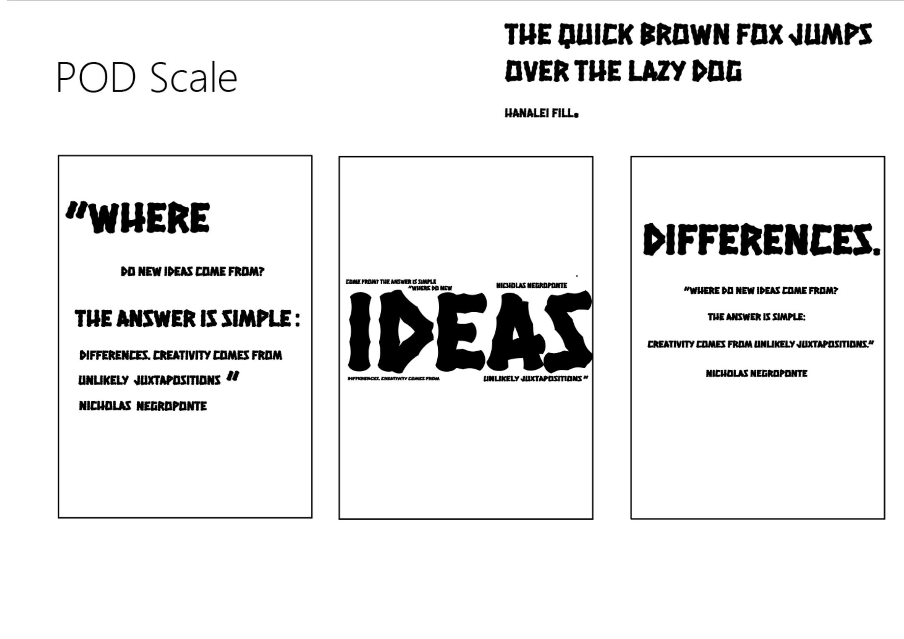
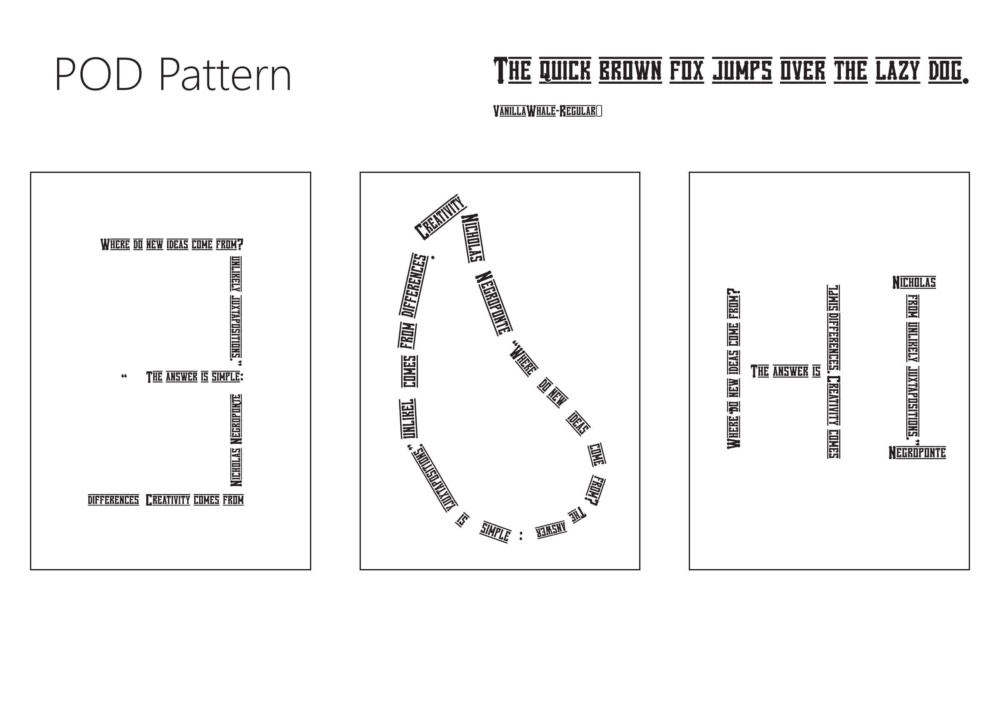
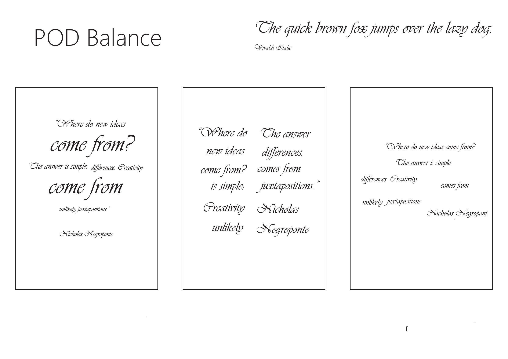
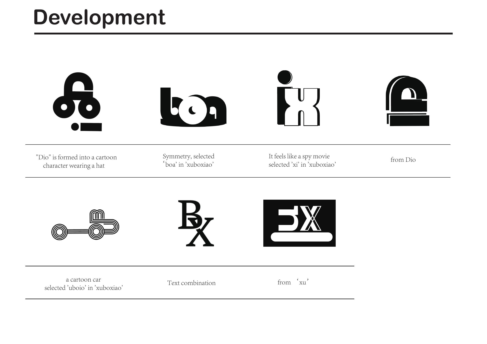
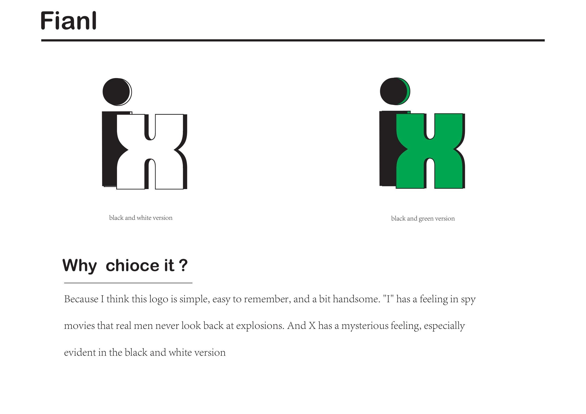
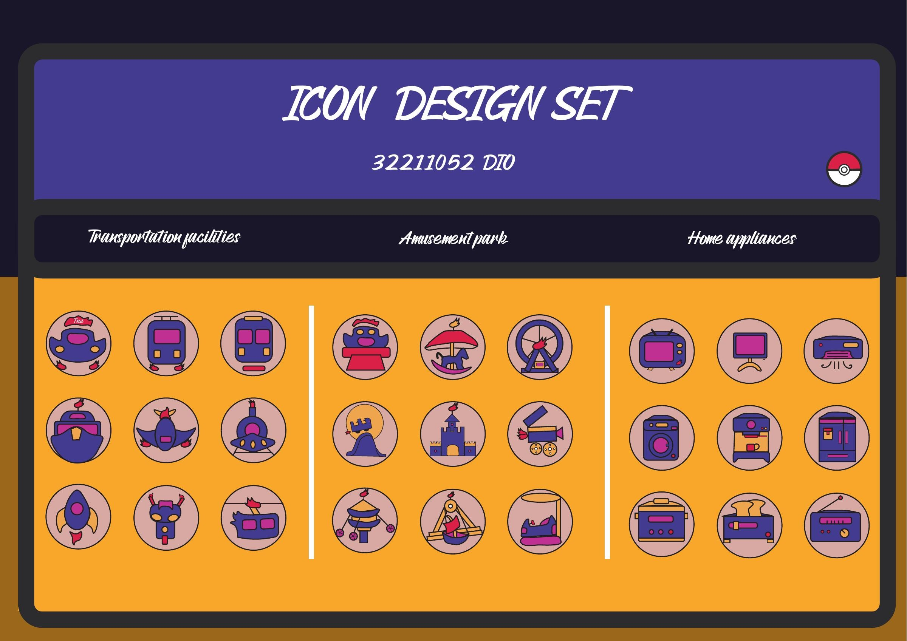
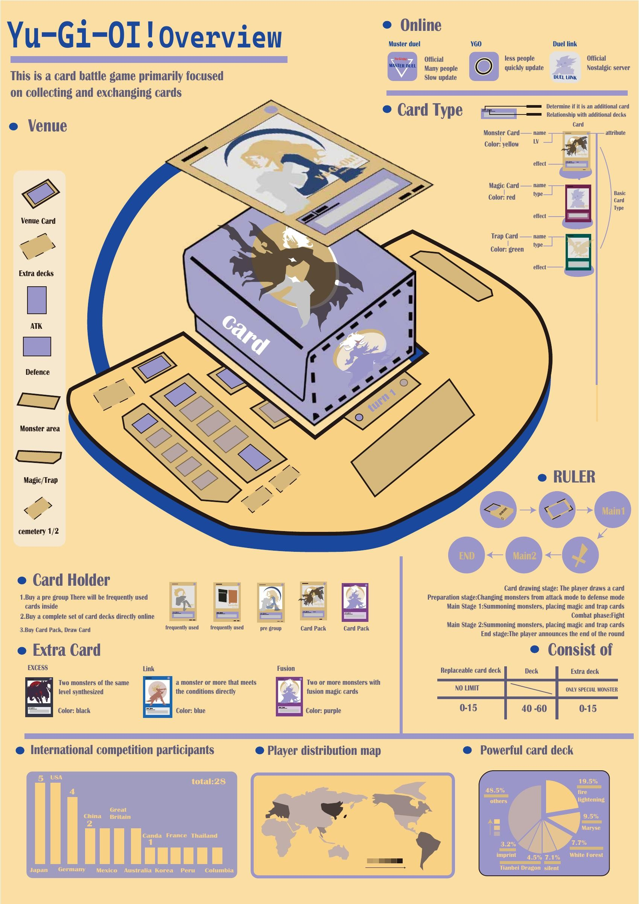
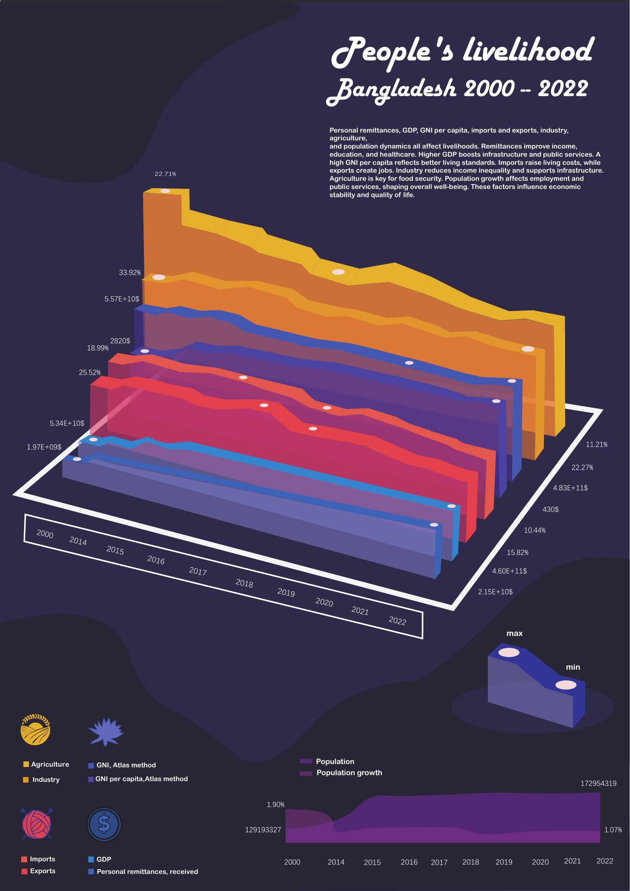

# Posters & Visual Design / 海报与视觉设计

[Open the gallery / 打开图片画廊](https://xuboxiao123.github.io/portfolio/visual-design.html) · [Back to portfolio](README.md)

Selected coursework from Year 2 onward (2023–2025). / 仅收录大二及之后的课程作品。

## Posters & Typography / 海报与版式

### Creative Poster / 创意海报

**2023–2024 · Year 2** — An expressive composition combining portrait collage, geometric forms and contrasting colours.

### Typography & Composition / 字体与版式

**2023–2024 · Year 2** — Typographic studies exploring scale, pattern and balance through alternative layouts.

## Logo & Identity / 标志与品牌

### Personal Visual Identity / 个人视觉标志

**2023–2024 · Year 2** — Personal mark development and a final identity in monochrome and colour.

## Information Design / 信息设计

### Pictogram System / 图标设计系统

**2024–2025 · Year 3** — A coordinated icon set covering transport, amusement parks and household appliances.

### Yu-Gi-Oh! Overview / 游戏王信息图

**2024–2025 · Year 3** — An illustrated overview of the card game, organising card types, play structure and supporting information.

### People’s Livelihood — Bangladesh 2000–2022 / 孟加拉民生数据可视化

**2024–2025 · Year 3** — An editorial data-visualisation poster presenting social and livelihood indicators over time. Historical coursework; the graphic is reproduced as submitted.

